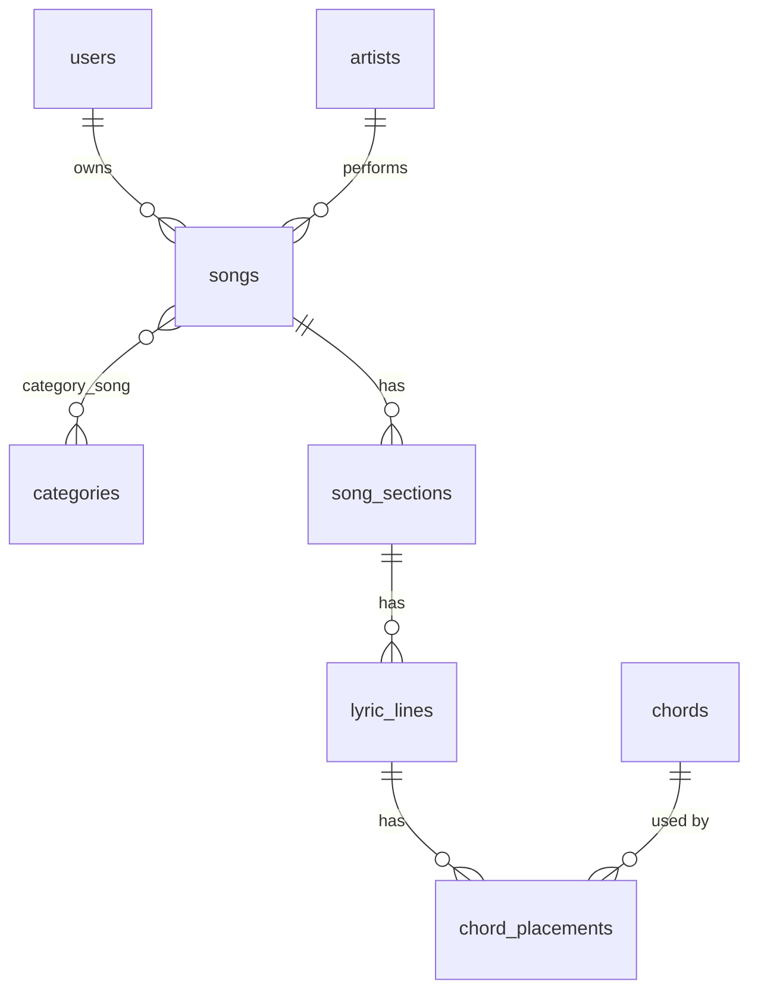
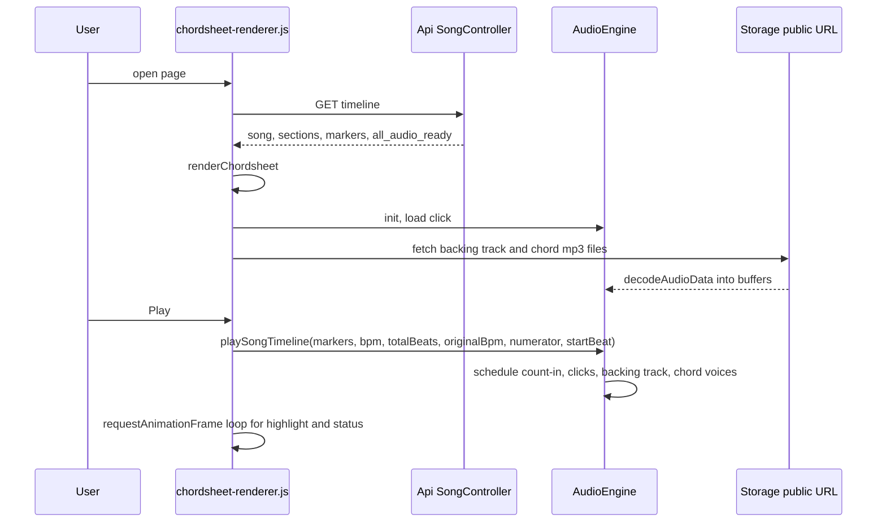
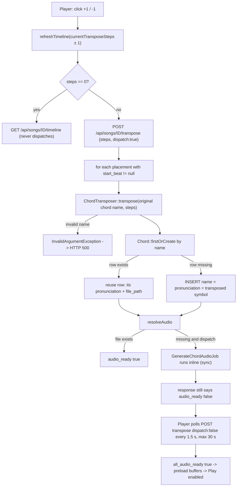

# Project B — Read-Only Behavior Analysis

> **Scope:** Player Page, Simple Editor Page, Beat Editor Page, and the TTS pipeline of Project B
> (`test-tts`, the experimental "ChordCue" build). This document describes **WHAT B does** (behavior)
> separately from **HOW B does it** (implementation), so that Project A can reuse the behavior
> without inheriting B's config, rules, or shortcuts.
>
> **Method:** All claims come from reading source files. No project file was modified, and no code
> was run except read-only shell listing/grep commands.
>
> **Legend**
> - **FACT** = seen directly in code (file path cited).
> - **ASSUMPTION** = inferred from code. It may be wrong.
> - ⚠️ **UNCLEAR / UNFINISHED** = contradictory, incomplete, or not verifiable from code alone.
>
> Paths are relative to the project root `test-tts/`.

---

## 0. Important context before reading

| # | Observation | Type |
|---|---|---|
| 0.1 | Git working tree has **uncommitted changes** in `.env.example`, `app/Jobs/GenerateChordAudioJob.php` (`pythonEnv()`), `config/sanctum.php`, `config/services.php` (python bin default). This analysis describes the **working tree** (what's on disk), not the last commit `bf458d7`. | FACT (`git status`, `git diff`) |
| 0.2 | `01-information/` has **untracked** PHP files: `tts.php`, `GenerateChordAudio.php`, `GenerateChordAudioCommand.php`, `ServeAllCommand.php`. These are **not wired into B**: no `config/tts.php`, no `app/Jobs/GenerateChordAudio.php`, no `app/Console/Commands/` directory. They describe a **different** TTS design (edge-tts CLI, `--write-media`, voice `id-ID-ArdiNeural`, rate `-10%`, folder `chords/audio`). | FACT |
| 0.3 | ⚠️ It is unclear whether the files in 0.2 are a draft for B, or come from Project A. **They are not B's behavior** and are excluded from the B analysis below. They are only mentioned for comparison in §5.6. | UNCLEAR |
| 0.4 | `01-information/*.md` / `.txt` (spec docs, build plan) describe *intended* behavior. Where code and docs disagree, this document follows the **code** and flags the mismatch. | FACT |
| 0.5 | The three pages are **standalone HTML documents**. They do not use the Breeze/Tailwind layout (`resources/views/layouts/app.blade.php`). Each page inlines its own CSS and loads plain JS files from `public/js/` with `<script src>`. No Vite bundling is involved. | FACT (`resources/views/songs/player.blade.php` L1-L299, `editor-simple.blade.php` L1-L710) |

---

## 1. Overall structure

### 1.1 Tech stack

| Layer | Tech | Source |
|---|---|---|
| Backend | PHP ^8.2, Laravel ^12, Laravel Sanctum ^4 (session/stateful API), Laravel Breeze-style auth views | `composer.json`, `bootstrap/app.php` (`$middleware->statefulApi()`), `resources/views/auth/*` |
| DB | MySQL (`DB_CONNECTION=mysql`, DB `test_tts`) | `.env.example` |
| Queue | `QUEUE_CONNECTION=sync` (jobs run **inline inside the HTTP request**) | `.env.example`, `.env` |
| Frontend (3 pages) | Vanilla JS classes/functions, **Web Audio API** (`AudioContext`, `AudioBufferSourceNode`, `GainNode`), HTML5 drag-and-drop, `fetch` | `public/js/audio-engine.js`, `public/js/chordsheet-renderer.js`, `public/js/chord-editor.js` |
| Frontend (other pages) | Blade + Tailwind + Alpine (via Vite) + `public/js/api-client.js` | `package.json`, `resources/views/layouts/app.blade.php` L37 |
| TTS | Python 3 + **`edge-tts`** library, called through Symfony `Process` | `scripts/edge_tts_stream.py`, `app/Jobs/GenerateChordAudioJob.php` |
| Tests | Pest (PHP feature/unit), one plain Node test for `beat-grid.js` | `tests/Feature/*`, `tests/Unit/*`, `tests/js/beat-grid.test.js` |

### 1.2 Folder roles

| Folder | Role in B |
|---|---|
| `app/Http/Controllers/` | Web controllers that return Blade pages (`SongPlayerController`, `SongWebController`, `ChordWebController`, `ChordAudioController`). `SongEditorController` exists but is **not routed** (dead code). |
| `app/Http/Controllers/Api/` | JSON API used by the three pages: `SongController` (CRUD + **timeline** + **transpose**), `ChordController`, `ChordPlacementController`, `SongSectionController`, `LyricLineController`, `SongAudioController`, `AuthController`. |
| `app/Jobs/` | `GenerateChordAudioJob`, the only TTS producer. |
| `app/Services/` | `ChordPlacementCoordinateService`: placement save + beat-collision detection + line display-start calculation. |
| `app/Support/` | `ChordTransposer` (semitone shift), `ChordSheetRenderer` (server-side chord-row builder; ⚠️ not used by the 3 pages). |
| `app/Policies/` | `SongPolicy`, `SongSectionPolicy`, `LyricLinePolicy`, `ChordPlacementPolicy`. **Only `SongPolicy::update` is used**, through the web route middleware `can:update,song`. No `authorize()` call exists anywhere in `app/` (grep). |
| `app/Models/` | Eloquent models (see §1.4). |
| `public/js/` | Page scripts: `audio-engine.js` + `chordsheet-renderer.js` (Player), `chord-editor.js` (both editors), `api-client.js` (other pages), `beat-grid.js` (⚠️ **not loaded by any page**; only used by `tests/js/beat-grid.test.js`). |
| `public/audio/` | Static assets: `click-short.mp3` (used), `click.mp3`, `dummy-chord.mp3` (⚠️ not referenced by the 3 pages). |
| `public/storage` → `storage/app/public` | Windows **junction** (`storage:link`). Holds `chord-audio/*.mp3` (TTS output) and `song-audio/*` (uploaded backing tracks). |
| `scripts/` | `edge_tts_stream.py`, the Python TTS bridge. |
| `resources/views/songs/` | `player.blade.php`, `editor-simple.blade.php`, `editor-beat.blade.php` (the 3 target pages). `editor.blade.php` and `edit.blade.php` are legacy and not reachable through routes (see §6). |
| `database/seeders/` | `ChordSeeder` (24 chords + **synchronous TTS generation**), `SongSeeder` (3 Indonesian songs), `CategorySeeder`, `DatabaseSeeder`. |

### 1.3 Routes relevant to the 3 pages (FACT, `routes/web.php`, `routes/api.php`)

| Route | Handler | Guard |
|---|---|---|
| `GET /songs/{song}/player` | `SongPlayerController@show` → `songs.player` | None at route level. Private songs are checked in the controller. |
| `GET /songs/{song}/editor/simple` | `SongWebController@simpleEditor` → `songs.editor-simple` | `auth` + `can:update,song` |
| `GET /songs/{song}/editor/beat` | `SongWebController@beatEditor` → `songs.editor-beat` | `auth` + `can:update,song` |
| `GET /songs/{song}/edit`, `GET /songs/{song}/editor` | Redirect to the simple editor | `auth` + `can:update,song` |
| `GET /api/songs/{song}/timeline` | `Api\SongController@timeline` | Visibility check only |
| `POST /api/songs/{song}/transpose` | `Api\SongController@transpose` | Visibility check only |
| `GET/PATCH /api/songs/{song}` | `Api\SongController@show/update` | See §6 (guest bypass) |
| `GET/POST /api/chords` | `Api\ChordController` | **None** |
| `POST/PATCH/DELETE /api/chord-placements[/{id}]` | `Api\ChordPlacementController` | **None** |
| `POST /api/chord-placements/{id}/transpose` | `Api\ChordPlacementController@transpose` | **None** (⚠️ not used by any page) |
| `POST /api/songs/{song}/sections`, `DELETE /api/sections/{id}` | `Api\SongSectionController` | **None** |
| `POST /api/sections/{id}/lines`, `DELETE /api/lines/{id}` | `Api\LyricLineController` | **None** |
| `POST/DELETE /api/songs/{song}/audio` | `Api\SongAudioController` | **None** |
| `POST /api/chord-audio/batch` | `ChordAudioController@batch` | **None** (⚠️ not used by any page) |

### 1.4 Data model (FACT, `database/migrations/2026_09_11_*`, `app/Models/*`)



| Table | Fields relevant to the 3 pages | Notes |
|---|---|---|
| `songs` | `id, user_id, title, artist_id, default_key, bpm (smallint, default 80), time_signature_numerator (nullable), time_signature_denominator (nullable), file_path (backing track, nullable), visibility enum(public, private)` | `Song::audio_url` = `Storage::disk('public')->url(file_path)` (`app/Models/Song.php` L38-L41) |
| `song_sections` | `id, song_id, name(45), sequence` | No timestamps |
| `lyric_lines` | `id, section_id, line_number, content(text)` | |
| `chord_placements` | `id, lyric_line_id, chord_id, position (int, NOT NULL), start_beat (int, nullable)` | **Dual coordinates.** `position` = character index in the lyric line (visual). `start_beat` = **global, 0-indexed beat across the whole song** (audio timing). (`..._000008_create_chord_placements_table.php` L19) |
| `chords` | `id, name(45, unique), pronunciation(45), file_path (nullable)` | `file_path` is the **TTS cache pointer** (one fixed voice for the whole system). `Chord::audio_url` → public URL (`app/Models/Chord.php` L35-L38) |

**Semantics of `start_beat` (FACT):** collision detection is song-wide (`ChordPlacementCoordinateService::savePlacement`, L114-L133). The Player schedules `marker.beat` as an absolute beat offset from song start (`audio-engine.js` L208-L212). So `start_beat` is a **global beat index starting at 0**.

---

## 2. Player Page

### 2.1 Purpose and user flow

**Purpose (FACT):** Practice/play-along view. It shows the chord sheet and plays a synchronized timeline of **metronome clicks + spoken chord names (TTS) + optional backing track**, with live tempo, transpose, per-track mute, and click-to-jump.

**User flow (FACT, `public/js/chordsheet-renderer.js`):**
1. The user opens `/songs/{id}/player` from the catalog (`resources/views/songs/index.blade.php` L223), from My Songs (`my-songs.blade.php` L208), or from an editor's "Buka Player" button.
2. The page auto-loads `GET /api/songs/{id}/timeline` (L32-L38, L371-L406). Status shows "Memuat data lagu...".
3. The chord sheet renders right away: section badges, a chord row above each lyric row, monospace (L107-L197).
4. Audio is prepared: `AudioContext` is created, the click sample is loaded, the backing track is decoded (if any), and each unique chord's TTS mp3 is decoded (L200-L219). When this succeeds, **Play** becomes enabled and the status shows `"<title>" siap diputar (<bpm> BPM)`.
5. **Play** → a one-bar count-in (N clicks, N = time-signature numerator), with the status counting "Hitungan Mundur: 1…N". The song then plays (L294-L321, L248-L292).
6. While playing, the chord whose TTS clip is currently sounding is highlighted (L277-L286).
7. **Stop** stops all audio and clears highlights (L323-L330). Playback also auto-stops at the estimated end (last chord beat + 4 beats + 0.5 s) (L251-L262, L303-L305).
8. **BPM controls** (−5, −1, input, +1, +5, Reset): clamped to 20–300. They do not persist. If playing, playback **restarts from beat 0** at the new tempo (L332-L348).
9. **Transpose** (−1, +1, Reset): calls `POST /api/songs/{id}/transpose {steps}`, re-renders the sheet with transposed chord names, waits/polls until the new chords' TTS audio is ready, then preloads it (L350-L367, L221-L235, L448-L482).
10. **Click a chord** in the sheet → playback restarts from that chord's beat, **with a one-bar count-in** (L485-L496).
11. **Mute toggles** for Metronome / Chord voice / Backing track: these toggle gain 0/1 live, even during playback (L499-L519; `audio-engine.js` L88-L99).

### 2.2 Behavior spec (provider/implementation-independent)

| ID | Behavior | Priority (ASSUMPTION) |
|---|---|---|
| P1 | Load a song's structure: ordered sections → ordered lines → chords positioned over lyric characters. | CORE |
| P2 | Render the chord sheet as "chord row above lyric row" with chords aligned to character positions. Section labels are shown. | CORE |
| P3 | Play a timeline where each chord is **announced by voice so the clip ends exactly at its beat** (speech starts at `beatTime − clipDuration`). | CORE (this is the product's core idea) |
| P4 | Metronome click on every beat from the start beat to the end. | CORE |
| P5 | One-bar count-in (numerator clicks) before the song's beat 0 (or the jump target). | CORE |
| P6 | Visual highlight of the chord currently being announced. | CORE |
| P7 | Play / Stop. Play is disabled until all audio is ready. Stop is disabled when idle. | CORE |
| P8 | Live BPM change (20–300), not persisted. Reset to the song's stored BPM. | CORE for a practice tool (ASSUMPTION) |
| P9 | Transpose ±N semitones for display **and** voice, without changing stored data. | NICE-TO-HAVE |
| P10 | Click a chord to jump playback to that beat. | NICE-TO-HAVE |
| P11 | Independent mute for metronome / chord voice / backing track. | NICE-TO-HAVE |
| P12 | Backing track plays aligned to beat 0 and is time-stretched by `bpm/originalBpm`. | EXPERIMENTAL (see §2.7 issues) |
| P13 | Status line that shows loading / countdown / playing / errors. | CORE (UX feedback) |
| P14 | Access: guests may open public songs. Private songs are visible only to the owner or an admin (403 on the page, 404 on the API). | CORE |

### 2.3 Main files

| File | Role |
|---|---|
| `routes/web.php` (`songs.player`) | Route |
| `app/Http/Controllers/SongPlayerController.php` L14-L31 | Visibility check; passes `songId`, `song`, `canEdit` |
| `resources/views/songs/player.blade.php` | Markup + inline CSS. Sets `window.SONG_ID` (L294). Loads the two scripts (L296-L297). |
| `public/js/audio-engine.js` | `AudioEngine` class, a global singleton `window.audioEngine` (L264) |
| `public/js/chordsheet-renderer.js` | Page controller: fetch, render, transport, BPM, transpose, mute, jump |
| `app/Http/Controllers/Api/SongController.php` `timeline()` L192-L199, `transpose()` L133-L147, `buildTimelineResponse()` L211-L306, `resolveAudio()` L312-L325 | Timeline DTO builder + on-demand TTS dispatch |
| `app/Support/ChordTransposer.php` | Semitone transposition |
| `public/audio/click-short.mp3` | Metronome sample |

### 2.4 State management and data flow

**Where the state lives (FACT):** module-level `let` variables in `chordsheet-renderer.js` (L20-L24): `displayData` (the last timeline response), `originalBpm`, `currentBpm`, `currentTransposeSteps`, `highlightFrame`. Audio state lives in the `AudioEngine` instance (`audio-engine.js` L16-L43): `buffers` (decoded audio cache keyed by `'click'`, `'song'`, or the **chord pronunciation text**), `activeSources`, `scheduledEvents`, `countInEvents`, gain nodes, `mutes`, `songStartTime`.



**Timeline response shape (FACT, `SongController.php` L291-L305):**
```jsonc
{
  "song": { "id", "title", "bpm", "time_signature_numerator", "time_signature_denominator",
            "file_path", "audio_url", "reference_audio_url" },
  "sections": [ { "id", "name", "sequence",
                  "lines": [ { "line_id", "line_number", "content",
                               "placements": [ PlacementItem ] } ] } ],
  "markers": [ PlacementItem + { "section", "section_sequence", "line_id", "line_number", "line_content" } ],
  "all_audio_ready": true
}
// PlacementItem = { chord_placement_id, position, beat, chord_name, chord_text, audio_url, audio_ready }
```
- Placements with `start_beat === null` are **skipped** in both `sections` and `markers` (L231-L233).
- `markers` are sorted by (section sequence, line number, position), **not by beat** (L286-L289).
- `chord_text` = `chords.pronunciation`. This is the text that was spoken, and it is the key in the engine's buffer cache.

### 2.5 Dependencies

- **Editors**: the editors are the only UI that writes placements. The Player depends on placements having a non-null `start_beat` (i.e. placed through the **Beat** editor or seeded).
- **TTS pipeline**: the Player needs every marker's `audio_ready === true`, otherwise Play stays disabled (see §2.7).
- **Backing track**: uploaded from the editors (`SongAudioController`).
- **Time signature**: edited in the editors. The Player uses it for count-in length.
- No shared JS with the editors. `chordsheet-renderer.js` re-implements its own chord-row builder (`buildChordRow` L64-L81). This duplicates `app/Support/ChordSheetRenderer.php`.

### 2.6 Timing logic (FACT, `audio-engine.js` L148-L239)

Let `spb = 60 / bpm`, `N = numerator`, `t0 = ctx.currentTime + 0.1`.
- `songStartTime = t0 + N·spb`.
- Count-in clicks at `songStartTime + k·spb` for `k = −N … −1`.
- Song clicks at `songStartTime + (beat − startBeat)·spb` for `beat ∈ [startBeat, totalBeats)`. `totalBeats = maxMarkerBeat + 4` (renderer L303-L305).
- Backing track: `start(songStartTime, offset = startBeat·spb)`, `playbackRate = bpm / originalBpm`.
- Chord voice: `start(max(beatTime − clipDuration, now + 0.01))`, where `beatTime = songStartTime + (beat − startBeat)·spb`. **The clip is scheduled to finish on the beat** (a "pre-announcement").
- Highlight window = `[chordStartTime, chordEndTime)`, i.e. while the clip is speaking, **before** the beat (renderer L283-L285).

### 2.7 Hacks, hardcoded values, issues

| # | Item | Type |
|---|---|---|
| P-H1 | `originalBpm`/`currentBpm` default to `120` if the song has no BPM (renderer L21-L22, L376). The BPM input's initial HTML value is `120` (view L265). | FACT |
| P-H2 | The `0.1 s` scheduling lead and the `0.01 s` late-clip nudge are hardcoded (`audio-engine.js` L167, L220). | FACT |
| P-H3 | End of song = last marker beat **+ 4** beats (hardcoded, ignores the time signature) + `0.5 s` (renderer L253, L304). | FACT |
| P-H4 | **Initial load never triggers TTS generation.** `timeline()` passes `dispatch=false` (L197). If any chord lacks audio, `preloadAudioFor` throws "Audio chord belum siap untuk: …" and Play **stays disabled**, with no retry (renderer L201-L204, L400-L404). Only the transpose path dispatches + polls. | FACT |
| P-H5 | Transpose polling: up to **30 s**, every **1.5 s**, calling `POST transpose` with `dispatch:false` (L221-L235). With `QUEUE_CONNECTION=sync`, the *first* transpose call itself blocks while TTS runs inline for each new chord. | FACT (config) / ASSUMPTION (latency impact) |
| P-H6 | **Transpose is a read operation with DB side effects.** It runs `Chord::firstOrCreate` for every transposed name, with `pronunciation = name` (e.g. `"C#maj7"`), so new chords appear in everyone's chord library, and **guests can trigger it** on public songs (`SongController.php` L238-L244). | FACT |
| P-H7 | `ChordTransposer` only knows **sharps** `C…B` in its chromatic table. Lowercase roots (`am`), whitespace, and `E#`/`B#` throw `InvalidArgumentException` (→ HTTP 500). Flats (`Bb`, `Eb`) do not throw but are mis-parsed as root `B`/`E` + suffix `b`, producing unnatural enharmonics like `Cb` or `C#b`. The bass note of a slash chord (`G/B`) is left untransposed (`app/Support/ChordTransposer.php` L8, L18-L20). | FACT |
| P-H8 | Transposed chords that are not seeded get `pronunciation = name` via `firstOrCreate`, so the TTS receives raw symbols like `"C#m"` or `"C#b"` rather than full spoken phrases. The spoken quality depends entirely on the voice service's normalizer (§5.5.3). | FACT / ASSUMPTION (spoken quality) |
| P-H9 | **Backing-track offset bug:** the jump offset uses the *current* BPM (`startBeat · 60/bpm`), but the buffer is at the original tempo. It should be `startBeat · 60/originalBpm` (`audio-engine.js` L198). `playbackRate` also changes **pitch** (no time-stretch). | FACT (code) / ASSUMPTION (audible effect) |
| P-H10 | The backing track assumes **beat 0 = the first sample of the file**. There is no offset/latency field. | FACT |
| P-H11 | Changing BPM while playing restarts from **beat 0**, not from the current position (renderer L343-L345). | FACT |
| P-H12 | ⚠️ The header comment says "Jump manual ke beat tertentu **tanpa** count-in ulang" (`audio-engine.js` L12), but the code **always** adds a count-in on jump (L144-L146, renderer L319). The docs and code contradict each other. | FACT / UNCLEAR intent |
| P-H13 | The buffer cache is keyed by pronunciation text. Two chords with the same pronunciation share a buffer. A chord pronounced `"click"` or `"song"` would collide with reserved keys. Buffers are never evicted. | FACT |
| P-H14 | `canEdit` is computed and passed to the view but **never used** (no edit link on the Player) (`SongPlayerController.php` L24; `player.blade.php`). | FACT |
| P-H15 | `audio_url` is absolute and built from `APP_URL` (`http://localhost:8000`). If the user browses from `127.0.0.1:8000`, `fetch` becomes cross-origin. | FACT (config) / ASSUMPTION (breakage) |
| P-H16 | The renderer has a fallback "group markers by section" path when `sections` is empty (L149-L196). The API always sends `sections`, so this is effectively dead code. | FACT / ASSUMPTION |
| P-H17 | All UI strings are hardcoded Indonesian. Fonts are loaded from Google Fonts CDN. | FACT |

---

## 3. Simple Editor Page

### 3.1 Purpose and user flow

**Purpose (FACT):** A structure + visual-chord editor. The user builds sections and lyric lines, then **drags chords onto lyric characters** (sets `position`). It also holds song-level settings (time signature, backing track) and the chord library.

**User flow (FACT, `public/js/chord-editor.js`, mode `'simple'`):**
1. The user enters from "Create song" (redirect after create, `create.blade.php` L167), from My Songs (`my-songs.blade.php` L212), or from legacy URLs `/edit` and `/editor` (redirect). Requires login and owner/admin.
2. The page loads `GET /api/songs/{id}` (full nested song) and `GET /api/chords` in parallel (L25-L51).
3. Sidebar: **Pustaka Chord** (chord library) chips showing name + pronunciation, a search box (300 ms debounce → `GET /api/chords?search=`), and a **"+ Custom"** button (L114-L130, L252-L281).
4. **Time Signature** inputs (numerator/denominator 1–16) + Save → `PATCH /api/songs/{id}` (L212-L250).
5. **Backing track bar**: Upload (mp3/wav/ogg, ≤ 15 MB) → `POST /api/songs/{id}/audio`. Delete → `DELETE`. Shows a "Terpasang / Belum ada" badge (L197-L209, L831-L878).
6. **Tambah Section** → `prompt()` for a name → `POST /api/songs/{id}/sections` (sequence = max + 1) (L726-L744).
7. Per section: **+ Baris** → `prompt()` for lyric text → `POST /api/sections/{id}/lines` (L764-L782). **Hapus** → confirm → `DELETE /api/sections/{id}` (cascades lines + placements) (L746-L761).
8. Per line: the lyric is shown as a strip of 12 px monospace character slots, with placed chord badges above at `left = position·12px` (L344-L439). The **×** button deletes the line after a confirm.
9. **Drag a chord chip onto a character** → `POST /api/chord-placements {lyric_line_id, chord_id, position}` (L404-L414).
10. **Drag an existing chord badge onto another character** → `PATCH /api/chord-placements/{id} {position}` (L415-L419).
11. **Double-click a chord badge** → confirm → `DELETE /api/chord-placements/{id}` (L373-L378).
12. After every mutation the editor re-fetches the full song and re-renders everything (L656-L658, etc.). A toast notification shows for 3.5 s (L880-L889).
13. Header: mode switch links (Sederhana / Beat Grid → separate pages), "Buka Player", and a back arrow to My Songs (`editor-simple.blade.php` L584-L619).

### 3.2 Behavior spec

| ID | Behavior | Priority (ASSUMPTION) |
|---|---|---|
| S1 | Create / delete sections (named, auto-ordered). | CORE |
| S2 | Create / delete lyric lines inside a section (auto-numbered). | CORE |
| S3 | Place a chord on a specific lyric character by drag-and-drop. | CORE |
| S4 | Move a placed chord to a different character. Delete a placed chord. | CORE |
| S5 | Chord library: list, search by name/pronunciation, drag source. | CORE |
| S6 | Add a custom chord (name + spoken pronunciation) → triggers TTS generation. | NICE-TO-HAVE (needed for chords outside the seed list) |
| S7 | Edit the time signature (affects beat grid + count-in). | CORE (beat logic depends on it) |
| S8 | Upload / replace / delete a backing track (mp3/wav/ogg ≤ 15 MB). | NICE-TO-HAVE |
| S9 | Navigation: switch to the Beat editor, open the Player, go back to My Songs. | CORE |
| S10 | Success/error feedback for every action. | CORE |
| S11 | Owner/admin-only access to the page. | CORE |
| — | *Not present:* rename/reorder sections, edit line text, reorder lines. The API supports `PATCH` for sections/lines, but the 3 pages have **no UI** for it. | ⚠️ Gap (§6) |

### 3.3 Main files

| File | Role |
|---|---|
| `routes/web.php` (`songs.editor.simple`) | Route with `auth` + `can:update,song` |
| `app/Http/Controllers/SongWebController.php` `simpleEditor()` L63-L67 | Eager-loads the song (⚠️ the loaded data is only used for the server-rendered header. JS re-fetches everything.) |
| `resources/views/songs/editor-simple.blade.php` | Markup/CSS. Boots `new ChordEditor(id, 'simple')` (L703-L707) |
| `public/js/chord-editor.js` | Shared `ChordEditor` class for both editors |
| `app/Http/Controllers/Api/ChordPlacementController.php` | Placement store/update/delete |
| `app/Services/ChordPlacementCoordinateService.php` | Save + collision logic |
| `app/Http/Controllers/Api/SongSectionController.php`, `LyricLineController.php`, `ChordController.php`, `SongAudioController.php`, `SongController.php` (`show`, `update`) | Supporting APIs |

### 3.4 State management and data flow

- **State (FACT):** fields on the `ChordEditor` instance: `song` (full nested JSON from `GET /api/songs/{id}`), `chords` (library), `mode`, `draggedChord`, `draggedPlacement` (L14-L23).
- **Update model (FACT):** "server is the source of truth, re-fetch after every write". There are no optimistic updates and no local diffing. Every successful mutation calls `loadSong()` and then `render()` (full DOM rebuild).
- **Song JSON shape** (Eloquent default serialization, `SongController::show`): `{ ...song columns, artist, categories, sections:[{ ..., lyric_lines:[{ ..., chord_placements:[{ id, lyric_line_id, chord_id, position, start_beat, chord:{id,name,pronunciation,file_path} }] }] }] }`.

### 3.5 Data models used
`Song`, `SongSection`, `LyricLine`, `ChordPlacement` (`position` only in this mode), `Chord`. See §1.4.

### 3.6 Dependencies
- Shares 100 % of its JS with the Beat editor (`chord-editor.js`). The two editors are the **same app with a different `mode` flag** and theme colors.
- Placing a chord triggers TTS generation if that chord has no audio yet (`ChordPlacementController@store`). Adding a custom chord also triggers TTS (`ChordController@store`).

### 3.7 Hacks, hardcoded values, issues

| # | Item | Type |
|---|---|---|
| S-H1 | ⚠️ **Simple-mode placements are invisible to the Player.** A drop sends only `position`, so the store saves `start_beat = null` (test `ChordPlacementCoordinateTest` "stores visual-only placement without deriving a beat"). The timeline **skips** null-beat placements (`SongController.php` L231-L233). | FACT |
| S-H2 | ⚠️ **Moving a chord in Simple mode erases its beat.** A PATCH with only `position` sets `$startBeat = null` (`ChordPlacementController.php` L280-L282). So a chord placed in the Beat editor and then nudged visually in the Simple editor drops out of playback. | FACT |
| S-H3 | The "dual-coordinate conversion" (§5.1 in the spec docs) is **not implemented**: `convertCoordinates()` never derives one coordinate from the other. It only defaults `position` to `0` (`ChordPlacementCoordinateService.php` L59-L85). | FACT |
| S-H4 | Character width is hardcoded to `12px` in both JS (`marker.style.left = position*12`, L362) and CSS (`.char-slot { width:12px }`). This breaks with any other font size. | FACT |
| S-H5 | Uses native `prompt()`/`confirm()` for all input. The custom-chord flow is two chained prompts (L802-L828). | FACT |
| S-H6 | Errors are swallowed: Add Section / Add Line / Delete have **no error branch**. For example, an empty lyric line → 422 from `'content' => required` fails silently (L737-L743, L775-L781; `LyricLineController.php`). | FACT |
| S-H7 | `chords.pronunciation` is `VARCHAR(45)` in the DB, but the API validates `max:75` (`..._create_chords_table.php` L17 vs `ChordController@store`). A 46–75-character pronunciation → DB error. | FACT |
| S-H8 | The time-signature inputs allow 1–16 in HTML, but the API only validates `integer` (no range) (`SongController.php` L164-L165). | FACT |
| S-H9 | The server-rendered header shows `Key: …` (`editor-simple.blade.php` L595). The JS then overwrites it with `… • visibility` (L185), so the displayed text changes after load. | FACT |
| S-H10 | The 15 MB / mp3,wav,ogg limit is hardcoded in `SongAudioController` (`max:15360`) and again in the `accept` attribute. | FACT |
| S-H11 | The JS references `#btn-mode-simple`/`#btn-mode-beat` (L95-L112). These exist only in the unrouted legacy `editor.blade.php`, so this is dead code on these pages. | FACT |
| S-H12 | **No API authorization** on section/line/placement/chord/audio endpoints (see §6). Page-level protection only. | FACT |

---

## 4. Beat Editor Page

### 4.1 Purpose and user flow

**Purpose (FACT):** A timing editor. The user places chords on **global beats** using a per-line bar/beat grid. This is the **only UI that produces playable placements** (non-null `start_beat`).

**User flow (FACT, `chord-editor.js` mode `'beat'`, `editor-beat.blade.php`):**
1. Same entry, auth, sidebar, time-signature box, backing-track bar, and header as the Simple editor. The hint text differs (beat-grid instructions). The theme is purple.
2. For each section → each line, a block shows the lyric text and **"Global Beat Start: X"**, followed by a horizontal row of **bars**. Each bar has *numerator* beat cells labeled 1…N (L496-L613).
3. **Line start beat (auto-continuation, FACT L60-L91):** `cumulative = 0`. For each line in order: `displayStart[line] = cumulative`. Then `maxUsed = max(start_beat on the line)`, or `cumulative + N − 1` if the line has none. Then `cumulative = ceil((maxUsed + 1)/N)·N`.
4. Bars shown per line = `ceil(max(N, maxBeatInLine − displayStart + 1)/N) + 1`. This always gives **one extra empty bar** to drop into (L515-L517).
5. **Drag a chord chip onto a cell** → `POST /api/chord-placements {lyric_line_id, chord_id, start_beat: globalBeat}` (L591-L596).
6. **Drag an existing chord badge to another cell** → `PATCH {start_beat}` (L597-L601).
7. **Collision:** if another placement anywhere in the song already has that beat, the server returns **409** with `colliding_placement`. A confirm dialog asks "Tabrakan Chord! … menimpa?". Confirming re-sends with `force:true`, and the server deletes the existing one and saves the new one (L635-L648, L681-L694; service L114-L133).
8. **Double-click a chord** → delete (L565-L570).
9. **+ Baris** per section is available. ⚠️ **There is no delete-line or delete-section button** in Beat mode (L463-L493 vs Simple L309-L341).

### 4.2 Behavior spec

| ID | Behavior | Priority (ASSUMPTION) |
|---|---|---|
| B1 | Per-line grid of bars × beats-per-bar (from the time-signature numerator). | CORE |
| B2 | Each line's grid starts where the previous line's used bars end (auto-continuation, bar-aligned). An empty line consumes one bar. | CORE (it defines how lyrics map onto time) |
| B3 | Drop a chord on a cell → stored as a **global** beat index. | CORE |
| B4 | Move/delete placed chords. | CORE |
| B5 | Only one chord per global beat per song. Conflicts produce an explicit overwrite confirmation. | CORE |
| B6 | Always show one spare bar per line for extending. | CORE |
| B7 | Show the beat number within the bar and a tooltip with the global beat. | NICE-TO-HAVE |
| B8 | Time-signature edit re-shapes the grid. | CORE |
| B9 | Chord library / custom chord / backing track / navigation, the same as the Simple editor. | (same as S5–S9) |

### 4.3 Main files
Same as §3.3, plus `resources/views/songs/editor-beat.blade.php` (boots `new ChordEditor(id, 'beat')`, script at L663) and `SongWebController::beatEditor()` L72-L76. `public/js/beat-grid.js` contains the **same algorithm as a tested pure module**, but ⚠️ the page doesn't load it. `chord-editor.js` has its own copy (L60-L91).

### 4.4 State and data flow
Identical to §3.4. The only difference is that `displayStarts` is **derived on every render** from current placements. It is not stored.

### 4.5 Hacks, hardcoded values, issues

| # | Item | Type |
|---|---|---|
| B-H1 | ⚠️ **Beat-placed chords all get `position = 0`** on create (service L79-L85; test "stores beat-only placement… position 0"). In the Player's chord row, several chords on the same line overwrite each other at column 0 (`chordsheet-renderer.js` `buildChordRow` L73-L79). In the Simple editor they stack at `left:0`. | FACT (code) / ASSUMPTION (visual result) |
| B-H2 | ⚠️ **Grid instability:** `displayStart` depends on the highest beat used on earlier lines. Adding a chord in the spare bar of line *k* shifts the start of every later line, but their stored global beats don't move. Earlier-placed chords on later lines can then fall **before** their line's new start and no longer render in the grid (cells are only created from `displayStart` onward, L534-L551). Playback still includes them. | ASSUMPTION (derived from code, not tested) |
| B-H3 | Lines whose chords are all null-beat (from the Simple editor) count as "empty" (one bar), and those chords are not shown in the grid. | FACT |
| B-H4 | Global-beat collision is **song-wide**, so a chord placed at beat 8 on line 1 blocks beat 8 everywhere, by design (test "detects collision across different lines"). | FACT |
| B-H5 | `force:true` deletes the colliding row **inside the transaction**, using `lockForUpdate` (service L118-L126). This is reasonable, but there is no undo. | FACT |
| B-H6 | ⚠️ **Seed data contradicts the beat model.** `SongSeeder` stores **per-line, 1-indexed, bar-relative** beats (`'beat' => 1`, `'beat' => 3`, repeated on every line) directly into `start_beat` with `ChordPlacement::create`, which bypasses collision checks. With the global model, many chords share beat 1/3, so the Player would announce them simultaneously, and the Beat editor would show them stacked in line 1's grid. | FACT (seed) / ASSUMPTION (runtime effect, though it follows from the code) |
| B-H7 | No delete-line/delete-section UI in Beat mode (see 4.1.9). | FACT |
| B-H8 | `numBars` always adds `+1`. The bar label restarts at "Bar 1" for each line (local numbering), while the cell tooltip shows the global beat. | FACT |

---

## 5. TTS (Text-to-Speech) deep dive

> **Revision note (2026-11-07):** This section was re-read line by line and expanded. Two claims in the
> previous version were **wrong** and are corrected here:
> 1. Flat chords (`Bb`, `Eb`) do **not** throw in the transposer. They are parsed as root `B`/`E` plus suffix `b` (§5.5.2).
> 2. The "0-byte mp3 gets saved" risk is mostly prevented by the `edge-tts` library itself. It raises `NoAudioReceived`, so the script exits non-zero (§5.2, §5.9).
>
> **Verification limits:** The MySQL server was not running during this analysis (`SQLSTATE[HY000] [2002]`
> from a read-only `SELECT`), so the **current contents of the `chords` table could not be checked**. I did not
> start the database, because that would change the environment. Evidence about what B actually generated comes from the audio
> files on disk (`storage/app/public/chord-audio/`) and from the tests.

### 5.1 Component map (every file that touches TTS)

| # | File | Lines | Responsibility |
|---|---|---|---|
| 1 | `config/services.php` | L38-L44 | `services.python.bin` (← `PYTHON_BIN`), `services.tts.default_voice` (← `TTS_DEFAULT_VOICE`, default `en-US-AriaNeural`) |
| 2 | `.env` / `.env.example` | — | `PYTHON_BIN` (local: absolute path to Python 3.13), `TTS_DEFAULT_VOICE="en-US-AriaNeural"`, `QUEUE_CONNECTION=sync` |
| 3 | `scripts/edge_tts_stream.py` | L1-L27 | Python bridge: `argv[1]` = text, `argv[2]` = voice → raw MP3 bytes on stdout |
| 4 | `app/Jobs/GenerateChordAudioJob.php` | L1-L97 | The **only** producer of audio files. It skips if cached, runs the script, writes the file, and sets `chords.file_path` |
| 5 | `app/Models/Chord.php` | L35-L38 | `audio_url` accessor → `Storage::disk('public')->url(file_path)` |
| 6 | `database/migrations/2026_09_11_000003_create_chords_table.php` | L16-L18 | `name VARCHAR(45) UNIQUE`, `pronunciation VARCHAR(45) NOT NULL`, `file_path NULL` |
| 7 | `app/Support/ChordTransposer.php` | L1-L33 | Pure string transposition of a chord **name** (sharps-only output) |
| 8 | `app/Http/Controllers/Api/SongController.php` | L133-L147, L211-L306, L312-L325 | Song-wide transpose, chord lookup/creation, readiness check, dispatch |
| 9 | `app/Http/Controllers/Api/ChordPlacementController.php` | L66-L73, L154-L183 | Dispatch on placement create. Single-placement transpose (unused by UI) |
| 10 | `app/Http/Controllers/Api/ChordController.php` | L17-L41, L46-L69 | Library listing with `audio_ready`. Custom chord create + dispatch |
| 11 | `app/Http/Controllers/ChordAudioController.php` | L16-L39 | Batch URL lookup by pronunciation/name (unused by UI) |
| 12 | `database/seeders/ChordSeeder.php` | L19-L44, L53-L67 | 24 base chords with spoken phrases + `dispatchSync` |
| 13 | `database/factories/ChordFactory.php` | — | Same 24 name→phrase pairs (tests/factories) |
| 14 | `public/js/chord-editor.js` | L802-L828 | Custom-chord UI (pronunciation prompt defaults to the chord name, L806) |
| 15 | `public/js/chordsheet-renderer.js` | L40-L56, L200-L235, L350-L367, L448-L482 | Player: request transpose, poll readiness, preload clips |
| 16 | `public/js/audio-engine.js` | L108-L120, L207-L238 | Decode + cache clips. Schedule them to end on the beat |
| 17 | `vendor/laravel/framework/src/Illuminate/Queue/SyncQueue.php` | L94, L126-L137, L220-L226 | How `dispatch()` behaves with `QUEUE_CONNECTION=sync` (framework, read for context) |
| 18 | `…/Python313/Lib/site-packages/edge_tts/` (v**7.3.1**) | `communicate.py` L74-L96, L263-L285, L327-L350, L408, L438, L561-L564; `constants.py` L3-L7 | Provider library internals (installed on the dev machine, **not pinned** by the project: there is no `requirements.txt` in `scripts/`) |

### 5.2 Provider and configuration

| Aspect | Detail | Type / Source |
|---|---|---|
| Library | `edge-tts` **7.3.1** (`edge_tts/version.py`). The project does not pin a version. | FACT |
| Endpoint | WebSocket `wss://speech.platform.bing.com/consumer/speech/synthesize/readaloud/edge/v1?TrustedClientToken=…`. The token is a **public constant inside the library**. There is no project API key. | FACT (`edge_tts/constants.py` L3-L7) |
| Service nature | Unofficial use of Microsoft Edge "Read Aloud". There is no SLA, it can be rate-limited or blocked, and it needs internet at generation time. | ASSUMPTION |
| Output format | Hardcoded by the library: **`audio-24khz-48kbitrate-mono-mp3`** (48 kbps CBR, mono). B doesn't choose it. | FACT (`communicate.py` L408, L438) |
| SSML | The library wraps the text as `<speak xml:lang='en-US'><voice name=…><prosody pitch='+0Hz' rate='+0%' volume='+0%'>TEXT</prosody></voice></speak>`. B passes no rate/pitch/volume, so the defaults apply. | FACT (`communicate.py` L263-L285, L327-L334) |
| Text sanitizing | The library removes control characters (code 0–8, 11–12, 14–31) and XML-escapes the text (`&`, `<`, `>`). **`#` passes through untouched.** The library does no pronunciation rewriting. How `#` is spoken is decided **by the Microsoft service's text normalizer**. | FACT (`communicate.py` L74-L96, L350) |
| Voice | `TTS_DEFAULT_VOICE` → job constructor L31 → passed as `argv[2]`. The script falls back to `en-US-AriaNeural` (L13) only if argv is missing. **One voice system-wide. The client never chooses.** | FACT |
| Voice captured when? | At **dispatch time** (constructor, L31), not at run time. With an async queue, a job keeps the voice it was created with. | FACT |
| Process call | `new Process([PYTHON_BIN, base_path('scripts/edge_tts_stream.py'), $text, $voice], base_path(), pythonEnv())` with `setTimeout(30)` | FACT (job L54-L66) |
| Windows env fix | Re-injects `SystemRoot`/`SYSTEMROOT`/`WINDIR` (on Windows only). This is uncommitted work-tree change. | FACT (job L83-L96, `git diff`) |
| Retry/timeout | `$tries = 3`, `$timeout = 30` (job L19-L20). These **only apply with a real worker**. Under `sync` they are ignored and the exception goes straight to the caller (§5.4.2). | FACT |

### 5.3 Where the spoken text comes from (chord → pronunciation)

The TTS never speaks the chord **symbol** directly. It speaks `chords.pronunciation`, falling back to `name` only if pronunciation is an empty string (job L45). The column is `NOT NULL` (migration L17), so the fallback is practically unreachable.

There are **five** code paths that create `chords` rows. Each one decides the pronunciation differently:

| # | Creation path | File / lines | Pronunciation written | TTS triggered? |
|---|---|---|---|---|
| C1 | Seeding | `ChordSeeder.php` L56-L59 (`firstOrCreate(['name'], ['pronunciation'])`) | Human phrase from a fixed map: `C#` → **"C Sharp Major"**, `Am` → "A Minor", `G7` → "G Dominant Seventh" (L19-L44) | Yes, **synchronous** `dispatchSync` per chord (L63) |
| C2 | Custom chord (editor "+ Custom") | `ChordController@store` L46-L59; UI `chord-editor.js` L802-L828 | Whatever the user types. The prompt **pre-fills it with the chord name** (L806), so pressing OK gives `pronunciation = symbol` | Yes, `dispatch` (L59) |
| C3 | **Song-wide transpose** (Player) | `SongController@buildTimelineResponse` L238-L244 | `Chord::firstOrCreate(['name' => $transposedName], ['pronunciation' => $transposedName])` → **pronunciation = raw symbol**, e.g. `"C#m"` | Only if `dispatch` is true (default for `POST /transpose`) and the audio is missing (L246 → L316-L319) |
| C4 | Single-placement transpose | `ChordPlacementController@transpose` L164-L167 | Same as C3 (raw symbol) | Yes, if missing (L171-L173). ⚠️ No UI calls this endpoint |
| C5 | Factory (tests) | `database/factories/ChordFactory.php` | Same phrase map as C1 | No |

**No code path ever updates `name` or `pronunciation` after creation**, and nothing regenerates audio. There is no chord update/delete endpoint (`routes/api.php` only has `GET`/`POST /api/chords`).

### 5.4 Generation pipeline (step by step)

#### 5.4.1 Inside `GenerateChordAudioJob::handle()` (FACT, `app/Jobs/GenerateChordAudioJob.php`)

| Step | Line | What happens |
|---|---|---|
| 1. Cache check | L40-L43 | If `file_path` is non-empty **and** `Storage::disk('public')->exists(file_path)` → log "hit" and return. The cache key is "this chord row already has an existing file". Text and voice are **not** part of the key. |
| 2. Choose text | L45 | `$text = pronunciation ?: name` |
| 3. Build filename | L46-L48 | `safeName = preg_replace('/[^a-zA-Z0-9_-]/', '_', strtolower(name))` → `chord-audio/chord_{id}_{safeName}.mp3`. **The filename comes from the chord *name*, not the pronunciation.** |
| 4. Ensure folder | L52 | `makeDirectory('chord-audio')` on the public disk (`storage/app/public`) |
| 5. Run Python | L54-L66 | Synchronous subprocess, 30 s timeout. Text and voice are passed as **separate argv entries** (no shell, so `#`, spaces, and quotes are safe) |
| 6. Python side | script L15-L23 | `edge_tts.Communicate(text, voice).stream()` → writes each `audio` chunk to `sys.stdout.buffer`. Metadata chunks (WordBoundary) are ignored |
| 7. Failure | L68-L71 | Non-zero exit → `Log::error` + `throw RuntimeException('TTS generation failed: ' . stderr)`. No file is written and `file_path` stays NULL |
| 8. Save | L73 | `file_put_contents(absolutePath, stdout)`. Overwrites any existing file with the same name. Not atomic (it writes in place) |
| 9. Persist pointer | L76-L78 | `$this->chord->update(['file_path' => 'chord-audio/…'])` |

**How `#` is handled in filenames (FACT, L46):** `#` is not in `[a-zA-Z0-9_-]`, so it becomes `_`:

| Chord name | `safeName` | File |
|---|---|---|
| `C#` | `c_` | `chord_3_c_.mp3` |
| `F#m` | `f_m` | `chord_25_f_m.mp3` |
| `C#maj7` | `c_maj7` | `chord_{id}_c_maj7.mp3` |
| `D/F#` | `d_f_` | `chord_{id}_d_f_.mp3` |
| `Bb` | `bb` | `chord_{id}_bb.mp3` |
| `B♭` (Unicode) | `b___` (each UTF-8 byte of `♭` → `_`) | — |

ASSUMPTION about intent: removing `#` matters because `#` in a URL starts the **fragment**. `…/chord_3_c#.mp3` would be requested as `…/chord_3_c` and return 404. The `{id}_` prefix keeps different names that collapse to the same `safeName` (`C#` vs `C/`) from overwriting each other.

#### 5.4.2 What `dispatch()` really does in B (`QUEUE_CONNECTION=sync`)

1. `GenerateChordAudioJob::dispatch($chord)` returns a `PendingDispatch`. Its `__destruct` dispatches the job **at the end of that statement** (`Foundation/Bus/PendingDispatch.php` L241-L252).
2. `SyncQueue::push` (L94) → `executeJob` builds a **serialized payload** (L126) → `SyncJob::fire()` (L131). With `SerializesModels`, the `Chord` is stored as an id and **re-queried from the DB** when the job is unserialized.
3. The job runs **inside the current HTTP request** (or seeder). If it throws, `handleException` **re-throws** to the caller (L220-L226), so the HTTP request fails with 500.

**Consequences (FACT from code, outcome ASSUMPTION where noted):**
- The caller's own `$chord` object is **a different instance** from the one the job updated. Any response built after dispatch still shows `file_path = null` / `audio_url = null` for a chord that was just generated. `SongController::resolveAudio` computes `$isReady` **before** dispatching (L314 vs L318) and reads `audio_url` **after** (L322) from the stale instance, so the first transpose response reports `audio_ready:false, audio_url:null` even though the file now exists. `ChordController@store` hardcodes `'audio_ready' => false` (L67).
- One request can spawn **several sequential Python processes**, one per missing chord (up to 30 s each). The request can then exceed PHP/web-server execution limits (ASSUMPTION: depends on XAMPP `max_execution_time`).
- Failures leave partial state. The chord row (C2/C3) or the placement row is **already committed** before the job throws, because there is no surrounding transaction.

#### 5.4.3 Seeder-time generation (FACT, `ChordSeeder.php` L53-L67)
`firstOrCreate` runs for each of the 24 entries, then `dispatchSync` (always synchronous, regardless of queue config). The job's own cache check makes reruns cheap. **If Python, network, or the voice fails on any chord, the exception aborts the seeder**, so the remaining chords, `CategorySeeder`, users, and `SongSeeder` are not run (`DatabaseSeeder.php` call order).

### 5.5 Transposition pipeline (how new chords appear and how `#` gets added)

#### 5.5.1 End-to-end flow



**Key facts:**
- The Player always sends the **cumulative offset from the original key** (`currentTransposeSteps ± 1`, `chordsheet-renderer.js` L452, L464), and the server always transposes **from the stored chord** (`$placement->chord->name`, `SongController.php` L235-L239). So repeated transposes don't drift.
- **Stored placements are never changed.** `chord_placements.chord_id` keeps the original chord (test `ChordTransposeTest` "transpose tidak mengubah chord_id…"). Only the response DTO carries the transposed chord's `chord_name`, `chord_text`, and `audio_url` (L248-L256).
- `steps === 0` skips the transposer completely (L238), so a malformed chord name can break transposing but never the normal view.
- Placements with `start_beat = null` are skipped before transposition (L231-L233). They are never transposed and never trigger TTS.

#### 5.5.2 The transposer algorithm (FACT, `app/Support/ChordTransposer.php`)

1. Regex `^([A-G]#?)(.*)$` (L18): **root** = one uppercase letter A–G plus an optional `#`. **suffix** = *everything else, kept verbatim*.
2. Look up the root in `['C','C#','D','D#','E','F','F#','G','G#','A','A#','B']` (L8-L10, L24). Strict match.
3. `newIndex = ((index + steps) % 12 + 12) % 12` (L29). Any integer works, including negative or more than 12.
4. Return `chromatic[newIndex] . suffix` (L31).

**This is the mechanism that adds `#`:** the output root always comes from the sharps-only table. Any root that lands on a black key gets a `#` spelling (`A#`, never `Bb`). The suffix (`m`, `maj7`, `sus4`, `/F#`, …) is glued on unchanged.

**Worked examples (derived by applying the code above):**

| Input | Steps | Root / suffix parsed | Output | Musically correct? |
|---|---|---|---|---|
| `C` | +1 | `C` / `` | `C#` | ✅ |
| `B` | +1 | `B` / `` | `C` | ✅ (wraps) |
| `C` | −1 | `C` / `` | `B` | ✅ |
| `Bm` | +1 | `B` / `m` | `Cm` | ✅ |
| `A` | +1 | `A` / `` | `A#` | ✅ pitch, always sharp spelling (never `Bb`) |
| `F#m7b5` | +2 | `F#` / `m7b5` | `G#m7b5` | ✅ |
| `C` | +12 / −12 / +24 | `C` / `` | `C` | ✅ (same row reused) |
| `Bb` | +1 | `B` / **`b`** | **`Cb`** | Pitch OK (C♭ = B), spelling odd |
| `Bb` | +2 | `B` / `b` | **`C#b`** | Pitch OK (= C), spelling nonsensical |
| `Eb` | −1 | `E` / `b` | **`D#b`** | Pitch OK (= D), spelling nonsensical |
| `D/F#` | +2 | `D` / `/F#` | **`E/F#`** | ❌ bass note not transposed (should be `E/G#`) |
| `C♯` (Unicode) | +1 | `C` / `♯` | **`C#♯`** | ❌ |
| `E#`, `B#` | any | root `E#` / `B#` not in table | **exception** "Root chord tidak dikenali" (L25-L27) | — |
| `am`, ` C`, `N.C.`, `H`, `` | any | regex fails | **exception** "Format chord tidak dikenali" (L18-L20) | — |

> Correction to the previous version: flats do **not** throw. They are mis-parsed as "root + suffix `b`". The pitch stays correct, but the names (`C#b`, `A#b`) are odd, and they create new DB rows (see 5.5.3).

#### 5.5.3 Lookup-or-create: the two branches after transposing (FACT, `SongController.php` L240-L243)

`Chord::firstOrCreate(['name' => $transposedName], ['pronunciation' => $transposedName])`

| Branch | Condition | Displayed `chord_name` | Spoken `chord_text` | Audio |
|---|---|---|---|---|
| **A: reuse** | A row with that `name` already exists (seeded, custom, or created by an earlier transpose) | Transposed symbol | **The existing row's pronunciation**, e.g. `C#` → **"C Sharp Major"** | Existing file if present. Otherwise dispatched |
| **B: create** | No such row | Transposed symbol | **The raw symbol**, e.g. **"C#m"**, "G#7", "C#b" | Missing → dispatched (sync, inline) |

**Effect on the 24 seeded chords when transposed +1 (derived from the seed list `ChordSeeder.php` L19-L44 + algorithm):**

| Seed | +1 result | Branch | Spoken text after transpose |
|---|---|---|---|
| C, C#, D, D#, E, F, F#, G, G#, A, A#, B (all 12 majors) | next major | **A** (all 12 major roots are seeded) | Proper phrase, e.g. "D Sharp Major" |
| Em → Fm, Bm → Cm | natural minor | **A** | "F Minor", "C Minor" |
| Cm → C#m, Dm → D#m, Fm → F#m, Gm → G#m, Am → A#m | sharp minor | **B** (sharp minors are not seeded) | Raw `"C#m"`, `"D#m"`, `"F#m"`, `"G#m"`, `"A#m"` |
| Cmaj7 → C#maj7, Dm7 → D#m7, G7 → G#7, Asus4 → A#sus4, Esus2 → Fsus2 | extended | **B** (only one root of each extended chord is seeded) | Raw symbol |

So **after any non-zero transpose, one song can mix spoken styles**. Majors say "D Sharp Major", while sharp minors and extended chords say the bare symbol ("D#m"). Every non-zero transpose of a minor or extended chord creates permanent `chords` rows. These then show up in **every user's chord library** (`ChordController@index` lists all rows, L19-L40) with pronunciation equal to the symbol.

**How `"C#m"` is actually spoken:** ⚠️ **UNVERIFIED.** B sends `C#m` as literal text inside SSML (§5.2). The Microsoft normalizer could say "C sharp m", "C hash m", "C number m", or "C pound m", and the result can differ by voice/locale. I could not test this without network calls and writing files, which a read-only analysis must avoid. Treat raw-symbol pronunciations as **unreliable**.

**Evidence on disk (FACT: files; ASSUMPTION: interpretation):** `storage/app/public/chord-audio/` contains `chord_25_f_m.mp3`, `chord_26_c_m.mp3`, `chord_28_g_m.mp3`, `chord_29_d_m.mp3` (all dated 2026-09-30, after the 2026-09-27 seed batch for ids 1–24). Their names match exactly the sharp-minor rows that branch B creates (`F#m`, `C#m`, `G#m`, `D#m`). ⚠️ `chord_27_b_.mp3` and `chord_30_b_sus4.mp3` imply names like `B#`/`B?sus4`. **The current transposer can never output `B#`**, so these came from an earlier transposer version, a custom chord, or manual data. This can't be confirmed while the DB is offline.

#### 5.5.4 Player-side handling of a transpose (FACT, `chordsheet-renderer.js`)

| Step | Lines | Behavior |
|---|---|---|
| Click ±1 / Reset | L448-L482 | Disables **Play only**. Stop and the transpose buttons stay enabled. Status shows "Transpose +1 diproses…" |
| Request | L40-L56 | `steps === 0` → `GET /timeline`. Otherwise `POST /transpose {steps, dispatch}` with CSRF header |
| Apply | L351-L357 | Sets `displayData`, **then** `currentTransposeSteps`, updates the "+N" label, and re-renders the sheet with transposed names (before the audio is ready) |
| Wait | L359-L365, L221-L235 | If `!all_audio_ready`: shows "Menunggu audio hasil transpose…" and polls `POST /transpose {dispatch:false}` **immediately, then every 1.5 s, for up to 30 s** |
| Preload | L366, L200-L219 | Decodes the backing track (again) + each unique `chord_text` clip into `engine.buffers` |
| Done | L453-L454 | Re-enables Play and shows "Transpose +N siap." |

### 5.6 Readiness, storage, URL, and playback consumption

| Concern | Detail | Source |
|---|---|---|
| Physical storage | `storage/app/public/chord-audio/*.mp3`, served through the junction `public/storage` | `config/filesystems.php` (`public` disk), `storage:link` |
| DB pointer | `chords.file_path` (relative path) | Job L76-L78 |
| "Ready" definition | `!empty(file_path) && Storage::disk('public')->exists(file_path)`, re-implemented in 5 places | Job L40, `SongController` L314, `ChordController` L29, `ChordPlacementController` L69 & L169, `ChordAudioController` L30 |
| URL | `{APP_URL}/storage/chord-audio/…`, absolute, built from `.env` `APP_URL=http://localhost:8000` | `Chord.php` L35-L38, `filesystems.php` |
| API exposure | Per placement: `chord_name` (display), `chord_text` (spoken), `audio_url`, `audio_ready`. Aggregate: `all_audio_ready` | `SongController.php` L248-L256, L304 |
| Client cache | `engine.buffers[chord_text] = AudioBuffer`, keyed by **spoken text**, never evicted | `audio-engine.js` L108-L120 |
| Playback | Each marker → new `AudioBufferSourceNode` → `chordVoiceGain` → destination | `audio-engine.js` L208-L238 |

### 5.7 Who triggers / who consumes TTS (by page)

| Actor | Triggers generation | Consumes audio |
|---|---|---|
| Seeder | C1, sync | — |
| **Simple editor** | Placing a chord whose audio is missing (`ChordPlacementController@store` L66-L73). Creating a custom chord (C2) | No. Shows the pronunciation text only. `audio_ready` from `/api/chords` is **not displayed**, and there is no preview button |
| **Beat editor** | Same as the Simple editor | Same |
| **Player** | Only through **non-zero transpose** with `dispatch:true` (C3) | Yes. It is the only consumer |
| Player initial load / transpose Reset (steps 0) | **Never** (`timeline()` passes `false`, L197) | Yes |
| Unused endpoints | `POST /chord-placements/{id}/transpose` (C4) | `POST /chord-audio/batch` (lookup only) |

### 5.8 Timing and sync, with measured clip lengths

**Scheduling rule (FACT, `audio-engine.js` L211-L221):** `beatTime = songStartTime + (beat − startBeat)·60/BPM`. `clipStart = beatTime − buffer.duration`. If that start is in the past, the clip starts at `now + 0.01 s`.

**Clip durations on disk (FACT: file sizes; ASSUMPTION: duration = bytes ÷ 6000, valid for 48 kbps CBR per `communicate.py` L408):**

| Spoken text (seed) | File | Bytes | ≈ Duration |
|---|---|---|---|
| "C Minor", "D Major", "A Minor", … (most triads) | `chord_2_cm.mp3`, `chord_4_d.mp3`, … | 11 232 | ~1.87 s |
| "C Sharp Major" | `chord_3_c_.mp3` | 13 392 | ~2.23 s |
| "C Major Seventh" | `chord_20_cmaj7.mp3` | 13 392 | ~2.23 s |
| "E Suspended Second" | `chord_24_esus2.mp3` | 14 256 | ~2.38 s |
| (transposed, raw text, unknown) | `chord_30_b_sus4.mp3` | 15 264 | ~2.54 s |

Many different phrases come out at exactly 11 232 bytes. My ASSUMPTION is that this reflects frame-quantized output with **leading/trailing silence**. `buffer.duration` includes that silence, so the *audible* speech ends **before** the beat by the length of the trailing silence. Verifying this would require decoding the files.

**Derived timing edge cases (ASSUMPTION: arithmetic on the code + measured sizes):**

| Situation | Calculation | Result |
|---|---|---|
| Two chords 2 beats apart at 120 BPM | gap 1.0 s < clip ~1.87 s | Clips **overlap** about 0.9 s. Both play on the same gain node (no ducking), and both chords highlight together (renderer L277-L286 adds `active` to every event in its window) |
| Densest overlap-free spacing at 120 BPM | 1.87 s ÷ 0.5 s | About **4 beats** (one chord per bar in 4/4). At 90 BPM about 3 beats |
| First chord on beat 0, 4/4 | count-in = 4·60/BPM must be ≥ clip | OK up to about **128 BPM** for 1.87 s clips, about **94 BPM** for 2.54 s clips. Faster → the clip starts at `now+0.01` and **ends after beat 0** (late) |
| First chord on beat 0, 3/4 | 3·60/BPM ≥ 1.87 | OK only up to about **96 BPM** |
| Live BPM increase | Clips are not time-stretched | Overlap gets worse. Clip speed never follows tempo |
| Jump to a beat | Same count-in rule | Same lateness risk for the target chord |
| Seeded songs (`SongSeeder`) | Per-line beats 1/3 stored as global beats (see B-H6) | Many clips scheduled at the **same** beats → simultaneous voices |

### 5.9 Edge-case catalog (TTS + transpose)

**A. Transposer input** (§5.5.2)
1. Lowercase / whitespace / `N.C.` / non A–G roots → `InvalidArgumentException` → **whole transpose request fails with 500** (`SongController.php` L239, uncaught).
2. `E#`, `B#` → exception (not in the table).
3. Flats → odd spellings (`Cb`, `C#b`, `A#b`) and new rows (branch B).
4. Slash chords → bass note left untransposed (wrong chord).
5. Unicode `♯`/`♭` → kept as a suffix, giving odd names, and `♭` produces `___` in filenames.
6. The output is always sharp spelling (`A#` never `Bb`), regardless of song key (`songs.default_key` is ignored).

**B. Lookup / DB**
7. Partial side effects on failure: chords created (and audio generated) for markers processed **before** the failing one stay in the DB. There is no transaction around the loop (L224-L284).
8. Race: two users transposing at once can both miss in `firstOrCreate` (select-then-insert) → one hits the `UNIQUE(name)` violation → 500 (ASSUMPTION).
9. Case-insensitive collision: MySQL uses `utf8mb4_unicode_ci` by default (`config/database.php` L57, not overridden in `.env`). `CM7` (major 7) and `Cm7` (minor 7) are **equal** for `UNIQUE` and for `firstOrCreate`. Transposing to `CM7` could **reuse the `Cm7` row**, which has the wrong pronunciation and wrong audio. A custom `CM7` would also be rejected as "already taken" (ASSUMPTION based on collation semantics. Tests use SQLite, which is case-sensitive (`phpunit.xml`), so tests would not catch it).
10. Pronunciation lock-in: once transpose creates `A#m` with pronunciation `"A#m"`, a user **cannot** create a custom `A#m` with a better phrase (`unique:chords,name`, `ChordController.php` L49), and no update endpoint exists.
11. Length mismatch: pronunciation is `VARCHAR(45)` but validation allows 75 (`ChordController.php` L50 vs migration L17) → DB error for 46–75 characters (strict mode).
12. Guests can create chord rows (transpose has no auth; §6 X1).

**C. Generation**
13. Python missing, network down, voice name invalid, or service rejects the request → non-zero exit → `RuntimeException` → 500 on the triggering request. Under `sync`, the row (chord/placement) is already saved, so the editor shows an error toast for an action that actually succeeded (e.g. `savePlacement` shows `err.message`, L650-L653, and **does not reload**, so the UI is stale).
14. Empty audio: `edge-tts` 7.3.1 raises `NoAudioReceived` (`communicate.py` L561-L564) → uncaught in the script → exit 1 → B's failure branch. So a 0-byte file is **unlikely**. (The previous version overstated this.) B itself still never validates the output size or format (job L73).
15. Timeout: 30 s per process (L65). The job `$timeout` is also 30 s. With a real worker, the worker could kill the job before the Process timeout fires (ASSUMPTION).
16. Non-atomic write (L73): a browser fetching during generation could get a partial file (ASSUMPTION: unlikely under sync).
17. Non-ASCII pronunciations on Windows: argv encoding between PHP `proc_open` and Python may mangle characters (ASSUMPTION, not tested).
18. Voice change (`TTS_DEFAULT_VOICE`) doesn't invalidate existing files (the cache key ignores voice), so the library ends up with **mixed voices**.
19. Orphan / overwritten files: names embed DB ids. A reseeded or fresh DB reuses ids and **overwrites or orphans** files. On disk: `chord_2_c.mp3`, `chord_2_cm.mp3`, `chord_2_g.mp3`, `chord_3_g.mp3` (same id, different names).
20. **Tests write real audio:** `phpunit.xml` uses `QUEUE_CONNECTION=sync`, and `tests/Feature/ChordPlacementCoordinateTest.php` posts placements **without `Queue::fake()` or `Storage::fake()`**. So running the suite spawns real `edge-tts` calls and writes into the real `storage/app/public/chord-audio/`, using the in-memory DB's ids (C=1, G=2, Am=3). ASSUMPTION: this explains `chord_1_c.mp3` / `chord_2_g.mp3` dated 2026-10-01.

**D. Sync-queue semantics** (§5.4.2)
21. The first transpose response always reports newly generated chords as `audio_ready:false` / `audio_url:null`. Readiness is only seen on the next poll.
22. If one chord appears several times in a song, the first occurrence can say `false` and later ones `true` in the **same** response. This happens because transposed chords are re-queried per placement (L240), so later iterations see the new file.
23. Polling requests (`dispatch:false`) never retry a failed generation. A retry only happens on the user's next ±1 click.
24. Seeder aborts entirely on the first TTS failure (§5.4.3).

**E. Player client**
25. **Play gets stuck disabled** if a transpose request fails (500) or polling times out. The handler disables Play (L450) and only re-enables it on success (L453). On timeout the sheet already shows the new key (L357) while the audio buffers are still the old ones.
26. Rapid clicks race: `currentTransposeSteps` only updates after the fetch resolves (L353), and the buttons aren't disabled. Two quick "+1" clicks can both send `steps:1`, ending at +1 instead of +2. Out-of-order responses can leave the label and sheet inconsistent.
27. Transposing **while playing** does not stop playback. Old voices keep playing while the sheet shows new names. Stop stays enabled.
28. The transpose label is unbounded (`+13`, `−25`), though the pitch wraps mod 12.
29. Longer transposed names (`C` → `C#`) shift the chord-row text. Adjacent chords can **overwrite each other's characters** in `buildChordRow` (L73-L79).
30. Initial load and Reset never dispatch. A song with any non-ready chord can only be "unblocked" by a non-zero transpose (which only generates the *transposed* chords) or by re-placing the chord in an editor.
31. The buffer key is the pronunciation. Different chords with identical pronunciation share a clip, and a pronunciation of `"click"` or `"song"` would clobber reserved buffers.

**F. Storage / URL**
32. Missing `storage:link`: `Storage::exists` checks `storage/app/public` directly, so `audio_ready` is **true** but the URL returns 404 → "Gagal mengunduh audio … (404)".
33. `APP_URL` host mismatch (`localhost` vs `127.0.0.1`) makes the absolute audio URLs cross-origin (ASSUMPTION about breakage).

### 5.10 Error handling and loading states (summary)

| Layer | Behavior |
|---|---|
| Job | Logs `info` on hit and success, `error` on failure, then throws (L41, L69-L70, L80) |
| API | No try/catch around dispatch or transpose, so failures surface as HTTP 500 (`SongController`, `ChordController`, `ChordPlacementController`) |
| Player | Status line messages: loading, "Menunggu audio…", "Transpose gagal: …", "Audio chord belum siap untuk: …". Play disabled during waits (with the stuck-state issue in #25) |
| Editors | Generic error toast. No TTS status, no retry, no preview |

### 5.11 Provider-independent contract (what B's TTS *is*, abstracted)

| Element | Definition |
|---|---|
| **Input** | `text` (spoken form of one chord) + `voice` (server-side constant) |
| **Output** | One browser-decodable audio clip + a public URL |
| **Cache identity** | B: one clip per `chords.id`, assuming text and voice never change. *(A should key on chord + text + voice.)* |
| **Readiness** | `audio_ready` per marker + `all_audio_ready` aggregate |
| **Triggers** | Seed (bulk), custom chord created, chord first used in a placement, transpose produced a chord |
| **Transpose rule** | Transpose the **display name** from the original stored chord by cumulative semitones. Map it to a chord-library entry (reuse if it exists, else create). Speak that entry's pronunciation. Never mutate stored placements |
| **Client duties** | Preload all clips before enabling Play. Schedule each clip to **end on its beat**. Use a separate mutable voice channel. Highlight while speaking. Wait/poll when a transpose introduces new clips |

**Provider-specific in B (replace):** the `edge_tts` library and its unofficial endpoint, the Python subprocess, `PYTHON_BIN`, Windows env injection, the voice id format `en-US-AriaNeural`, the fixed MP3 24 kHz/48 kbps output, stdout transport, 30 s process timeout, and generation inside HTTP requests (`sync`).

**General logic (keep, but fix):** chord ≠ spoken text (a pronunciation per chord), cache once per chord, readiness flags, dispatch on first need, cumulative transpose from the original, a lookup-or-create library entry for transposed chords, filename sanitization (no `#` in URLs), end-on-beat scheduling. **Fix in A:**
- Generate pronunciations for transposed or new chords with a **rule-based speller** (root + accidental + quality → "C sharp minor"), not the raw symbol.
- Handle flats and slash chords.
- Choose sharp/flat spelling from the key.
- Make transpose side-effect-free, or restrict who can trigger creation.
- Include voice and text in the cache key.
- Validate the audio output.
- Generate asynchronously with retries.

---

## 6. Cross-cutting hacks and risks (B-specific)

| # | Item | Source | Type |
|---|---|---|---|
| X1 | **API has almost no authorization.** Sections, lines, placements, chords, backing-track upload/delete, and transpose are callable by anyone (stateful Sanctum is enabled, but no `auth:sanctum` and no `authorize()`). Policies exist but are unused. | `routes/api.php`, grep `authorize` = 0 hits in `app/` | FACT |
| X2 | `SongController@update/destroy` skips the ownership check when **no user** is logged in (`if ($user && …)`). Guests can edit/delete any song through the API. | `SongController.php` L155, L180 | FACT |
| X3 | `SongController@store` falls back to `User::first()` / `user_id = 1` for guests. | `SongController.php` L102, L111 | FACT |
| X4 | The quota "10 songs" is hardcoded in 4 places. | `SongWebController.php` L38, `SongController.php` L105, `AuthController@quota`, `SongPolicy::create` | FACT |
| X5 | `QUEUE_CONNECTION=sync`: TTS runs inside user requests. | `.env.example` | FACT |
| X6 | Dead/unrouted code: `SongEditorController`, `songs/editor.blade.php`, `songs/edit.blade.php` + `SongWebController@edit`, `ChordAudioController@batch`, `ChordPlacementController@transpose` (no UI), `public/js/beat-grid.js` (not loaded), `ChordSheetRenderer.php`, `public/audio/dummy-chord.mp3`, `click.mp3`. | grep | FACT |
| X7 | `/chords` route returns `view('chords.index')`, but `resources/views/chords/` **does not exist**, so this would fail at runtime. | `ChordWebController.php`, filesystem | FACT |
| X8 | Section/line/placement FK constraints have no `cascadeOnDelete`. `SongController@destroy` calls `$song->delete()` directly, which will likely fail on MySQL once sections exist. | migrations `_000006`–`_000008`, `SongController.php` L184 | FACT / ASSUMPTION (failure) |
| X9 | The two editors and the Player duplicate logic (chord-row building, display-start algorithm in JS ×2 and PHP ×1). | `chord-editor.js` L60, `beat-grid.js`, `ChordPlacementCoordinateService.php` L21 | FACT |
| X10 | Section/line rename, reorder, and line-text edit exist in the API but not in the 3 pages' UI. | `SongSectionController@update`, `LyricLineController@update` | FACT |

---

## 7. Feature priority summary (ASSUMPTION — my judgment)

| Page | CORE | NICE-TO-HAVE | EXPERIMENTAL |
|---|---|---|---|
| Player | Load + render sheet, Play/Stop, metronome, count-in, chord voice ending on beat, speaking highlight, live BPM, readiness gating, status feedback, visibility rules | Transpose, click-to-jump, per-track mute | Backing-track sync (offset bug, pitch shift, no audio offset), transpose that writes chords to DB |
| Simple editor | Section/line CRUD, drag chord to character, move/delete, chord library + search, time signature, navigation | Custom chord, backing-track upload | "Visual-only" placements with no beat (they break playback) |
| Beat editor | Bar/beat grid from the time signature, auto-continuation, global beat placement, move/delete, collision 409 + overwrite confirm, spare bar | Global-beat tooltips | — (the model is sound, but see B-H1/B-H2) |

---

## 8. Open questions / unclear items

1. ⚠️ **Intended relationship between `position` and `start_beat`.** The spec says "dual-coordinate conversion", but the code stores them independently and defaults `position` to 0. Should a rebuild **derive** one from the other, or **require both**?
2. ⚠️ **Should a jump re-count-in?** The comment says no, the code says yes.
3. ⚠️ **Seeded beat semantics** (bar-relative, 1-indexed) vs the global 0-indexed model. Which one is intended?
4. ⚠️ **Should chord highlight be on the beat or during speech?** B highlights during speech (before the beat).
5. ⚠️ Origin and status of the untracked files in `01-information/` (§0.2).
6. ⚠️ Backing-track alignment: is beat 0 really the file start? There is no offset field.
7. ⚠️ Should transpose use flats/enharmonic spelling based on key? B is sharps-only.

---

## 9. Final lists

### 9.1 Behavior to preserve in Project A

1. Song structure model: **Song → ordered Sections → ordered Lyric Lines → Chord Placements**, with chords coming from a shared **chord library** (name + spoken pronunciation).
2. **Two coordinates per placement**: a visual character position on the lyric line, and a **global beat index** for timing. (Fix the coupling; see the "do not carry over" list.)
3. Chord sheet rendering: chord row aligned above lyric characters, grouped under section labels.
4. Player transport: **Play / Stop**, Play disabled until all audio is ready, status/feedback line.
5. **One-bar count-in** using the time-signature numerator.
6. **Metronome click on every beat**, on its own channel.
7. **Chord voice announcement scheduled to finish exactly on the chord's beat.**
8. **Highlight** of the active chord during playback.
9. **Live BPM** adjustment (20–300, ±1/±5/reset, not persisted).
10. **Transpose** by semitones for both display and voice, **without modifying stored placements**.
11. **Click-to-jump** to a chord's beat.
12. **Independent mute** for metronome / chord voice / backing track.
13. Optional **backing track** (mp3/wav/ogg, size-limited) that is replaceable/deletable and plays aligned with beat 0.
14. Simple editor: section create/delete, line create/delete, **drag chord onto a lyric character**, move, delete (double-click or equivalent), chord search, **custom chord with pronunciation**.
15. Beat editor: **bars × beats-per-bar grid per line**, **auto-continuation** (line starts at the next bar boundary after the previous line's last used beat; an empty line = one bar), **one spare bar**, drag to place/move, delete.
16. **One chord per global beat per song**, with explicit **conflict → confirm overwrite** (409-style) semantics, done atomically.
17. Time-signature editing that drives both the grid and the count-in.
18. Access rules: public songs playable by guests, private songs owner/admin only, editors owner/admin only.
19. TTS contract (§5.6): server-controlled single voice, **pronunciation-based text**, **generate once and cache per chord**, `audio_ready` per marker + aggregate, generation triggered on chord creation / first use / transpose, client preloads and gates Play.
20. Timeline API concept: one call that returns song meta + nested structure + flat beat-ordered markers with spoken text, audio URL, and readiness.

### 9.2 Experimental / B-specific things that should NOT be carried over

1. The Python subprocess bridge (`scripts/edge_tts_stream.py`), the `PYTHON_BIN` absolute path, and the Windows `SystemRoot` env injection.
2. `QUEUE_CONNECTION=sync`, i.e. TTS generation inside HTTP requests. Retries/timeouts that only work with a worker.
3. Writing TTS output without validating it is non-empty or decodable.
4. File naming that embeds DB ids (`chord_{id}_{safe}.mp3`), which leaves orphans on reseed. A cache key that ignores text/voice changes.
5. Transpose as a **read endpoint that creates `chords` rows** (and does so for guests), with `pronunciation = symbol` for new chords.
6. A sharps-only transposer that mis-parses flats (treating 'b' as suffix), ignores slash chord bass notes, and throws exceptions on lowercase roots.
7. Visual-only placements with `start_beat = null` that silently disappear from playback. A PATCH with `position` only that **erases** the beat. Beat-only placements defaulting to `position = 0`.
8. The non-implemented "coordinate conversion" (`convertCoordinates`) as designed.
9. The `SongSeeder` beat data (bar-relative, 1-indexed, colliding), inserted while bypassing collision rules.
10. The missing API authorization: unused policies, the guest bypass in `SongController@update/destroy`, the `User::first()` / `user_id = 1` fallback.
11. The quota value `10` duplicated in 4 places. Other hardcoded magic numbers: `+4` end beats, `120` BPM fallback, 12 px char width, 15 MB.
12. `prompt()` / `confirm()`-based editing UX and silently swallowed API errors.
13. Full re-fetch and full DOM re-render after every single mutation.
14. Duplicated algorithms (display-start ×3, chord-row ×2) and the unused tested module (`beat-grid.js`) while the page uses an untested copy.
15. Backing-track sync via `playbackRate` (pitch shift) with the wrong jump offset (`startBeat·60/currentBpm`).
16. Restarting playback from beat 0 on BPM change.
17. Absolute audio URLs from `APP_URL` (host-mismatch risk). Use relative or signed URLs instead.
18. `chords.pronunciation` length mismatch (DB 45 vs validation 75).
19. Standalone pages with inline CSS, CDN fonts, and globals (`window.SONG_ID`, `window.audioEngine`). Hardcoded Indonesian strings.
20. Dead code: `SongEditorController`, `editor.blade.php`, `edit.blade.php`, `ChordAudioController@batch`, the placement-level transpose endpoint, the broken `/chords` page, and unused audio assets.
21. The untracked `01-information/*.php` TTS variant. It is not part of B. Evaluate it separately against A's own rules if needed.
