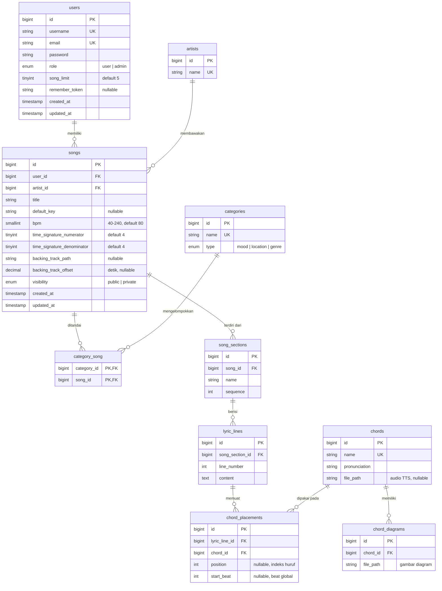
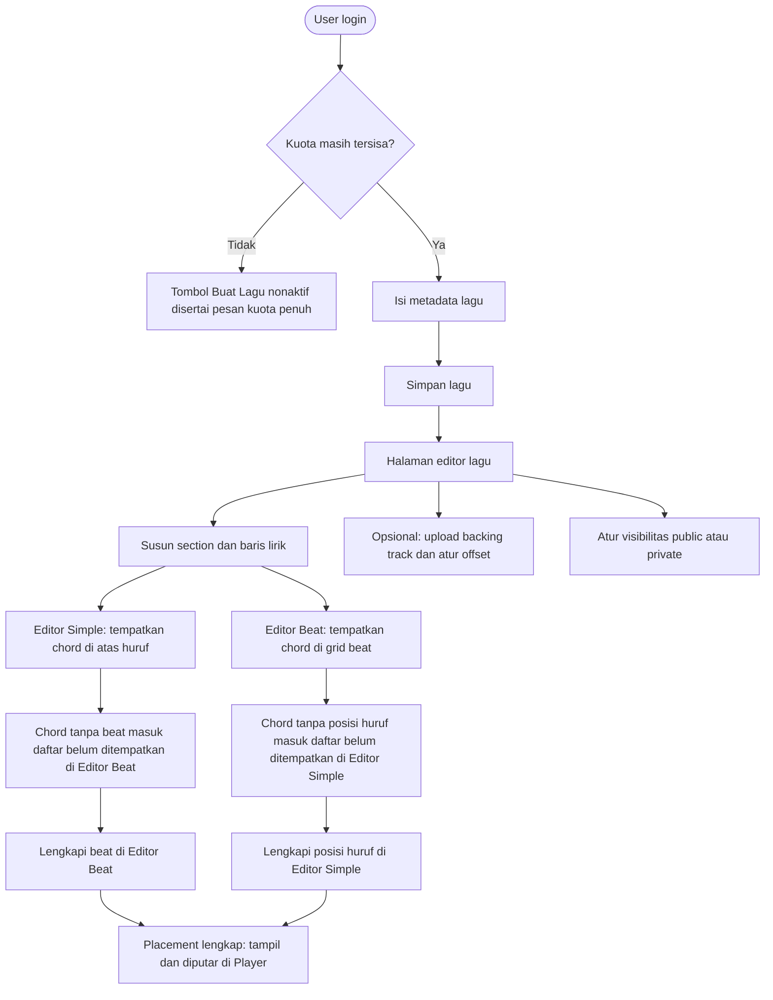
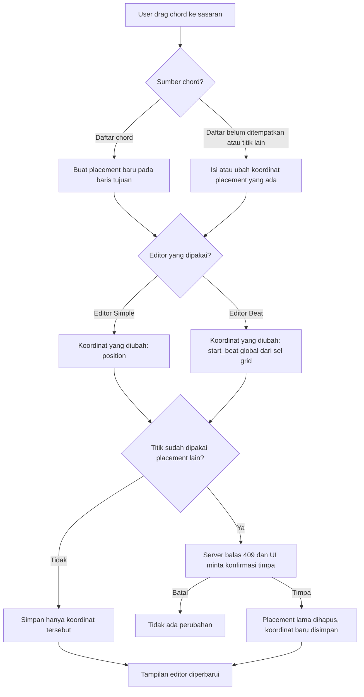
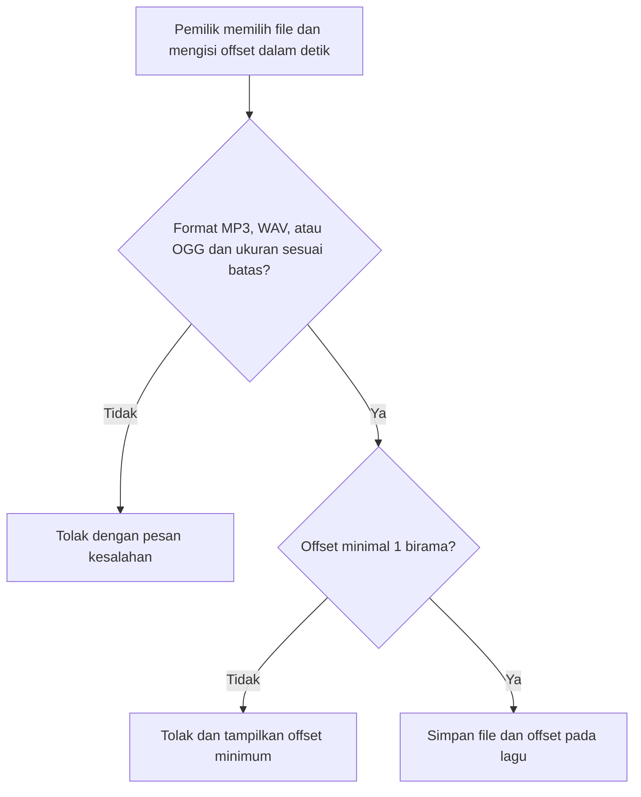
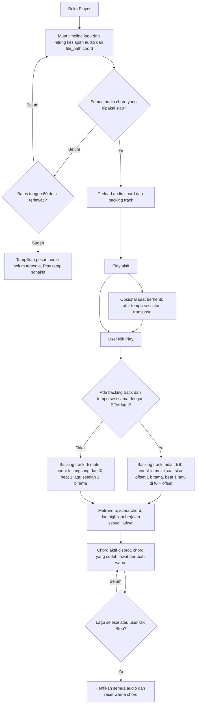
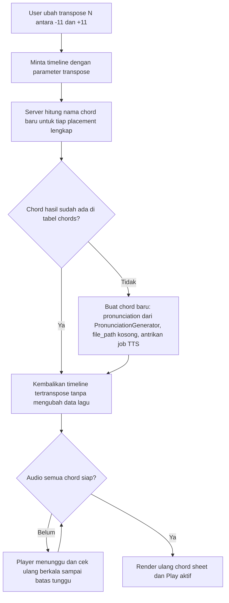
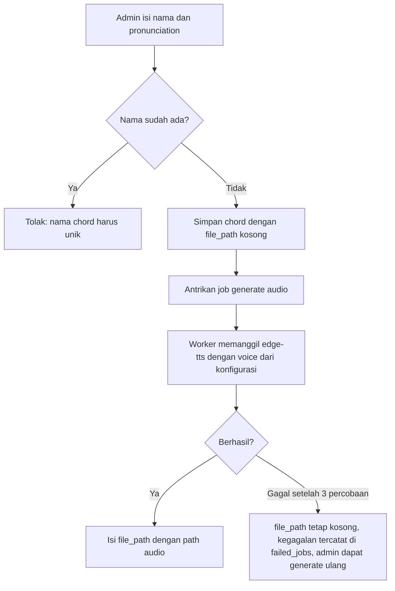

# Spesifikasi Sistem — ChordCue
### Aplikasi Web Chord Sheet Interaktif untuk Latihan Iringan Gitar

Dokumen ini adalah acuan tunggal spesifikasi sistem ChordCue: apa yang dibuat, bagaimana aturannya, dan bagaimana datanya disusun. Jika ada bagian yang ambigu saat implementasi, konfirmasi dulu ke product owner sebelum berasumsi.

---

## Daftar Isi

1. [Ringkasan Produk](#1-ringkasan-produk)
2. [Cakupan Sistem](#2-cakupan-sistem)
3. [Stack Teknologi & Konfigurasi](#3-stack-teknologi--konfigurasi)
4. [Aktor & Hak Akses](#4-aktor--hak-akses)
5. [Fitur Sistem](#5-fitur-sistem)
6. [Model Data](#6-model-data)
7. [Aturan & Algoritma Inti](#7-aturan--algoritma-inti)
8. [Alur Pengguna](#8-alur-pengguna)
9. [Halaman & Endpoint](#9-halaman--endpoint)
10. [Kebutuhan Non-Fungsional](#10-kebutuhan-non-fungsional)
11. [Glosarium](#11-glosarium)

---

## 1. Ringkasan Produk

### 1.1 Tujuan

ChordCue membantu **gitaris yang sudah bisa membaca chord** mengiringi lagu dengan lebih tepat, khususnya agar **perpindahan chord jatuh tepat pada tempo**. Saat sesi latihan, sistem memutar metronom, aba-aba suara chord, dan (opsional) backing track secara bersamaan, sambil menyorot chord yang sedang berjalan pada chord sheet.

### 1.2 Gagasan Inti

1. **Chord sheet dengan dua dimensi posisi.** Setiap chord punya posisi terhadap *huruf* pada lirik (untuk dibaca) dan posisi terhadap *beat* (untuk dimainkan). Keduanya diatur di dua editor terpisah dan tidak saling mengubah.
2. **Aba-aba suara chord.** Nama chord diucapkan (TTS) sehingga selesai tepat sebelum beat pergantian chord, memberi gitaris waktu bersiap pindah chord.
3. **Sesi latihan terkontrol.** Pengguna dapat mengubah tempo, men-transpose, dan me-mute metronom, suara chord, atau backing track secara terpisah.

---

## 2. Cakupan Sistem

### 2.1 Dalam Cakupan

- Registrasi, login, logout, dan tiga peran akses: Guest, User, Admin.
- Katalog dan pencarian lagu publik, dengan filter kategori per tipe (mood, lokasi, genre).
- Pembuatan dan pengeditan lagu (metadata, section, baris lirik) dengan kuota per user.
- Editor Simple (posisi chord terhadap huruf) dan Editor Beat (posisi chord terhadap beat).
- Upload backing track beserta offset-nya.
- Player latihan: metronom, count-in, suara chord, backing track, mute per track, tempo sesi, transpose sesi.
- Pembuatan audio chord otomatis (TTS) dan pembentukan pengucapan chord otomatis.
- Gambar diagram untuk tiap chord (satu atau lebih per chord), ditampilkan di halaman Pustaka Chord beserta filter chord dasar.
- Panel admin: kelola lagu, user, chord (termasuk diagram), artis, dan kategori.

### 2.2 Di Luar Cakupan

- Duplikasi lagu otomatis. User yang ingin memiliki versi sendiri dari lagu publik membuatnya manual (lirik, chord, dan beat diisi sendiri).
- Lompat manual ke bagian tertentu saat lagu diputar.
- Penambahan chord oleh user (hanya admin).
- Verifikasi email saat registrasi.
- Lebih dari satu voice TTS.
- Mengubah tempo atau transpose saat lagu sedang berjalan.
- Mengubah kecepatan backing track.
- Pengubahan aturan pengucapan lewat antarmuka (aturan berada di file konfigurasi, lihat §7.6).

---

## 3. Stack Teknologi & Konfigurasi

### 3.1 Stack

| Komponen | Pilihan |
|---|---|
| Framework backend | Laravel 12 |
| Database | MySQL |
| Starter kit | Laravel Breeze, stack **Blade with Alpine** |
| Autentikasi | Session (bawaan Breeze); login dengan email dan password |
| Frontend | Blade + Alpine.js untuk antarmuka; modul Vanilla JS untuk mesin audio, dibundel dengan Vite |
| Mesin audio | Web Audio API (`AudioContext`) |
| Text-to-Speech | `edge-tts` (paket Python), dipanggil dari Laravel Queue job lewat antarmuka `ChordAudioGenerator` sehingga implementasinya dapat diganti |
| Antrian | Laravel Queue, driver `database` (bawaan Laravel 12) |
| Penyimpanan file | Laravel Filesystem; disk dapat dikonfigurasi (disk lokal atau object storage), tidak terikat satu lokasi |
| Pengujian | Pest |

### 3.2 Prasyarat Lingkungan Hosting

Penyedia hosting belum ditentukan, sehingga sistem tidak mengikat diri pada satu lingkungan. Lingkungan yang dipilih harus menyediakan:

- **PHP 8.2+ dan MySQL** (kebutuhan Laravel 12), serta kemampuan membangun aset Vite saat deploy.
- **Penyimpanan file yang persisten.** Backing track, audio chord, dan gambar diagram disimpan lewat Laravel Filesystem, dan database hanya menyimpan path relatif, sehingga disk dapat berpindah (disk lokal ↔ object storage) tanpa mengubah data. Hosting dengan disk sementara (ephemeral) wajib memakai object storage.
- **Pemrosesan antrian.** Berupa worker yang berjalan terus (`queue:work`) atau, untuk hosting tanpa proses permanen, `queue:work --stop-when-empty` yang dipicu tiap menit oleh scheduler/cron.
- **Python 3, paket `edge-tts`, dan akses internet keluar**, hanya jika pembuatan audio memakai implementasi `edge-tts`. Jika hosting tidak menyediakannya, implementasi `ChordAudioGenerator` diganti tanpa mengubah bagian sistem lain.

### 3.3 Konfigurasi Aplikasi

Pengaturan khas aplikasi berada di `config/chordcue.php` dengan nilai bawaan tertulis langsung di file, sehingga **tidak memerlukan variabel `.env` khusus**. Kode memakai `config('chordcue.…')`.

| Kunci config | Nilai bawaan | Fungsi |
|---|---|---|
| `chordcue.tts_voice` | `en-US-AriaNeural` | Voice tunggal untuk seluruh audio chord |
| `chordcue.backing_track_max_mb` | `15` | Batas ukuran file backing track |
| `chordcue.chord_diagram_max_mb` | `2` | Batas ukuran satu gambar diagram chord |
| `chordcue.cue_margin_ms` | `50` | Jeda aman antara akhir suara chord dan beat chord (lihat §7.4) |

Aturan pengucapan chord berada di `config/pronunciation.php` (lihat §7.6). Pengaturan khas lingkungan (koneksi database, driver antrian, disk penyimpanan) memakai konfigurasi bawaan Laravel dan diatur per lingkungan; dokumen ini tidak mengikatnya ke satu penyedia. Kuota lagu awal untuk user baru (5) ditentukan oleh nilai bawaan kolom `users.song_limit`.

---

## 4. Aktor & Hak Akses

| Aktor | Deskripsi |
|---|---|
| **Guest** | Pengunjung yang belum login |
| **User** | Pengguna terdaftar dengan role `user` |
| **Admin** | Pengguna dengan role `admin` |

| Kemampuan | Guest | User | Admin |
|---|:-:|:-:|:-:|
| Mencari dan membuka lagu publik | Ya | Ya | Ya |
| Memakai Player (tempo sesi, transpose, mute) | Ya | Ya | Ya |
| Membuka halaman Pustaka Chord (referensi chord dan diagram) | Ya | Ya | Ya |
| Melihat lagu privat | — | Milik sendiri | Semua |
| Membuat lagu | — | Ya (dibatasi kuota) | Ya (tanpa kuota) |
| Mengedit dan menghapus lagu | — | Milik sendiri | Semua |
| Upload backing track dan atur offset | — | Milik sendiri | Semua |
| Kelola user | — | — | Ya |
| Kelola chord (termasuk diagram), artis, kategori | — | — | Ya |

Guest tidak dapat memiliki lagu pribadi. Admin dibuat lewat seeder (akun admin pertama); registrasi publik selalu menghasilkan role `user`.

---

## 5. Fitur Sistem

### 5.1 Autentikasi

- **Registrasi terbuka**: `username` (unik), `email` (unik), password (dengan konfirmasi). Tanpa verifikasi email. Role awal `user`, kuota awal `song_limit` = 5.
- **Login** dengan email dan password, berbasis session; **logout**.
- Fitur bawaan Breeze lainnya (profil, ganti password) dipakai apa adanya.

### 5.2 Katalog & Pencarian

- Menampilkan lagu dengan `visibility = public`.
- Pencarian kata kunci pada **judul** dan **nama artis**.
- Filter **artis** dan tiga filter kategori terpisah menurut tipe: **mood**, **lokasi**, dan **genre**. Semua filter dapat dikombinasikan.
- Urutan terbaru lebih dulu, dengan pagination (12 lagu per halaman).
- Kartu lagu menampilkan judul, artis, nada dasar, BPM, time signature, pemilik, dan penanda adanya backing track.
- Klik kartu membuka Player.

### 5.3 Manajemen Lagu

**Metadata lagu**

| Field | Aturan |
|---|---|
| Judul | Wajib |
| Artis | Wajib, dipilih dari tabel master artis |
| Kategori | Opsional, boleh lebih dari satu dari tipe apa pun (mood, lokasi, genre), dipilih dari tabel master kategori |
| Nada dasar (`default_key`) | Opsional, teks pendek (mis. `C`, `Am`, `F#m`) |
| BPM | Wajib, bilangan bulat 40–240 (bawaan form: 80) |
| Time signature | Wajib: pembilang dan penyebut, masing-masing bilangan bulat 1–32. Bawaan: 4/4. Jumlah beat per bar = **pembilang** |
| Visibilitas | `public` atau `private` (bawaan: `private`) |

**Struktur lagu**

- Lagu terdiri dari **section** (nama bebas, mis. Intro, Verse, Chorus) yang berurutan.
- Tiap section berisi **baris lirik** yang berurutan. Isi baris wajib terisi.
- Urutan global baris dalam lagu: urut `section.sequence`, lalu `line_number`.
- Menghapus section menghapus baris dan chord di dalamnya. Menghapus baris menghapus chord pada baris itu.

**Kuota**

- Kuota (`users.song_limit`) adalah batas **jumlah lagu yang dimiliki** user, publik maupun privat.
- Nilai awal 5, dapat diubah admin per user. Admin tidak dibatasi kuota.
- User hanya dapat membuat lagu baru jika jumlah lagunya masih di bawah kuota. Server menolak pembuatan lagu saat kuota penuh; UI menonaktifkan tombol dan menampilkan pesan.
- Menghapus lagu mengembalikan satu slot. Jika admin menurunkan kuota di bawah jumlah lagu yang sudah ada, lagu tidak dihapus; user hanya tidak bisa membuat lagu baru.

**Perubahan BPM dan time signature**

- Mengubah time signature mengubah pengelompokan bar di Editor Beat, tetapi **tidak mengubah nilai `start_beat` tersimpan**.
- Pada lagu yang punya backing track, perubahan BPM atau time signature ditolak jika membuat offset tersimpan kurang dari 1 birama pada pengaturan baru (lihat §5.5).

### 5.4 Editor Chord

Satu chord yang ditempatkan pada sebuah baris disebut **placement**. Placement punya dua koordinat yang **independen**:

- **Posisi huruf (`position`)**: indeks karakter (mulai 0) pada isi baris lirik. Diatur di **Editor Simple**.
- **Beat (`start_beat`)**: nomor beat **global** dari awal lagu (beat pertama lagu = 1). Diatur di **Editor Beat**.

Mengubah satu koordinat **tidak pernah** mengubah koordinat lainnya, dan tidak ada konversi otomatis di antara keduanya.

**Status placement**

| `position` | `start_beat` | Status | Perilaku |
|---|---|---|---|
| Terisi | Terisi | **Lengkap** | Tampil di chord sheet Player dan ikut diputar |
| Terisi | Kosong | Belum punya beat | Tampil di Editor Simple; masuk daftar "belum ditempatkan" di Editor Beat; tidak diputar |
| Kosong | Terisi | Belum punya posisi huruf | Tampil di Editor Beat; masuk daftar "belum ditempatkan" di Editor Simple; tidak diputar |
| Kosong | Kosong | Belum ditempatkan | Masuk daftar "belum ditempatkan" di kedua editor |

**Editor Simple**

- Menampilkan lirik per section dan baris; chord ditempatkan di atas huruf tertentu dengan drag-and-drop dari daftar chord.
- Menjatuhkan chord dari daftar ke huruf membuat placement baru dengan `position` terisi dan `start_beat` kosong.
- Daftar "belum ditempatkan" (per baris) berisi placement yang `position`-nya kosong; menjatuhkannya ke huruf akan mengisi `position`.

**Editor Beat**

- Menampilkan grid bar dan beat **berlapis per baris lirik**, mengikuti time signature lagu (jumlah kolom beat per bar = pembilang). Cara grid dihitung ada di §7.2.
- Menjatuhkan chord dari daftar ke sel grid membuat placement baru pada baris tersebut dengan `start_beat` terisi dan `position` kosong.
- Daftar "belum ditempatkan" (per baris) berisi placement yang `start_beat`-nya kosong; menjatuhkannya ke sel grid akan mengisi `start_beat`.

**Aksi pada placement**

| Aksi | Efek |
|---|---|
| **Tempatkan** | Mengisi koordinat milik editor yang sedang dipakai |
| **Pindah** | Mengubah hanya koordinat milik editor yang sedang dipakai |
| **Lepas** | Mengosongkan koordinat milik editor yang sedang dipakai; chord kembali ke daftar "belum ditempatkan" editor itu dan koordinat editor lain tidak berubah |
| **Hapus** | Menghapus placement seutuhnya (hilang dari kedua editor) |

**Aturan tabrakan**

- Setiap **beat** hanya boleh diisi satu chord dalam satu lagu (lintas baris, karena timeline beat bersifat global).
- Setiap **posisi huruf** hanya boleh diisi satu chord dalam satu baris.
- Jika koordinat yang dituju sudah terpakai, sistem meminta konfirmasi **timpa**. Jika user setuju, placement lama **dihapus seluruhnya** dan placement baru menempati titik itu.

**Daftar chord di editor**: semua chord pada tabel `chords` (dikelola admin, termasuk chord yang dibuat otomatis oleh transpose). User hanya memilih dari daftar ini. Daftar yang sama dipakai di Editor Simple dan Editor Beat, dan **hanya menampilkan nama chord, tanpa diagram**. Diagram dapat dilihat di halaman Pustaka Chord (§5.11).

Daftar dilengkapi **kolom pencarian**: teks yang diketik dicocokkan dengan penulisan nama chord (cocok pada bagian mana pun dari nama, tidak peka huruf besar/kecil), dan daftar langsung menyempit ke chord yang cocok. Contoh: mengetik `m7` menampilkan `Am7`, `Dm7`, `F#m7`, dan seterusnya; mengetik `f#` menampilkan `F#`, `F#m`, `F#m7`.

**Perubahan lirik**: jika isi baris diubah sehingga sebuah `position` melebihi panjang baru, placement itu otomatis di-**lepas** dari posisi hurufnya (kembali ke "belum ditempatkan" di Editor Simple).

### 5.5 Backing Track & Offset

- Satu lagu boleh punya **satu** file backing track (`songs.backing_track_path`). Format: MP3, WAV, OGG. Ukuran maksimum 15 MB (`chordcue.backing_track_max_mb`).
- File disimpan lewat Laravel Filesystem dengan nama acak; menghapus backing track atau lagu juga menghapus filenya.
- **Offset** (`songs.backing_track_offset`, detik, boleh desimal) adalah waktu dari awal file hingga **beat pertama lagu**. Offset menentukan kapan metronom (count-in) dan lagu mulai berbunyi agar selaras dengan backing track. Offset terisi jika dan hanya jika backing track ada.
- **Validasi offset**: minimal **1 birama**, yaitu `pembilang × 60 / BPM lagu` detik. Contoh: 4/4 pada 90 BPM → minimal 2,667 detik.
- Pada form upload, tampilkan petunjuk: *"Offset adalah detik dari awal file sampai ketukan pertama lagu. Minimal satu birama, karena hitungan mundur (count-in) dimulai satu birama sebelum lagu."*

### 5.6 Player Latihan

**Kontrol**

| Kontrol | Perilaku |
|---|---|
| **Play / Stop** | Play memulai sesi dari awal; Stop menghentikan semua audio dan mengembalikan tampilan ke awal |
| **Mute metronom** | Mematikan/menyalakan suara metronom |
| **Mute audio chord** | Mematikan/menyalakan suara aba-aba chord |
| **Mute backing track** | Mematikan/menyalakan backing track. Nonaktif jika lagu tidak punya backing track atau tempo sesi ≠ BPM lagu |
| **Tempo sesi** | Input BPM 40–240 untuk sesi ini saja. Bawaan = BPM lagu. Tidak disimpan ke lagu |
| **Transpose** | Geser nada −11 sampai +11 semitone untuk sesi ini saja (lihat §5.7) |

- Mute bisa diubah kapan saja, termasuk saat lagu berjalan. Mute hanya menurunkan volume ke 0; penjadwalan audio tetap berjalan.
- **Tempo sesi dan transpose hanya bisa diubah saat lagu berhenti.** Keduanya kembali ke bawaan saat halaman dimuat ulang.
- Jika tempo sesi berbeda dari BPM lagu, **backing track otomatis di-mute** dan tombol mutenya dinonaktifkan. Ketika tempo dikembalikan ke BPM lagu, tombolnya aktif kembali dengan status sebelum tempo diubah.

**Chord sheet pada Player**

Hanya placement berstatus **lengkap** yang ditampilkan dan diputar. Tiap chord punya tiga keadaan visual:

| Keadaan | Kapan |
|---|---|
| Normal | Belum dimainkan |
| **Aktif** (disorot) | Dari beat chord itu sampai beat chord berikutnya |
| **Sudah dimainkan** (warna berubah) | Setelah beat chord itu lewat; warna dipertahankan sampai lagu selesai |

Saat lagu selesai atau Stop ditekan, semua chord kembali ke keadaan Normal.

**Kesiapan audio**

- Audio sebuah chord dianggap **siap** jika `chords.file_path` terisi. Kesiapan dihitung server setiap kali data Player diminta.
- Tombol Play nonaktif sampai seluruh audio chord yang dipakai lagu siap dan terunduh (preload), dan selama lagu belum punya satu pun placement lengkap.
- Bila ada audio yang belum siap, Player menampilkan progres dan memeriksa ulang setiap 3 detik, maksimal 60 detik. Setelah batas itu Player menampilkan pesan bahwa audio belum tersedia (Play tetap nonaktif); admin dapat men-generate ulang audio dari menu Kelola Chord.

Mekanisme waktu (count-in, offset, penjadwalan) dijelaskan di §7.4.

### 5.7 Transpose Sesi

- Rentang −11 sampai +11 semitone, hanya berlaku di tampilan dan audio sesi Player. **Tidak mengubah data lagu.**
- Berlaku juga untuk Guest.
- Nama chord hasil transpose dihitung di server (lihat §7.5). Jika chord hasil belum ada di tabel `chords`, sistem **otomatis membuatnya**: pengucapan dibentuk oleh `PronunciationGenerator` (§7.6), `file_path` dibiarkan kosong, lalu audionya dibuat lewat antrian TTS.
- Nada dasar lagu yang ditampilkan ikut bergeser bila formatnya dapat diurai.

### 5.8 Audio Chord (TTS)

- Satu voice tetap untuk seluruh sistem (`chordcue.tts_voice`). Teks yang diucapkan adalah `chords.pronunciation`.
- Audio dibuat oleh job antrian saat: admin menambah chord; admin mengubah nama/pengucapan chord; chord baru dibuat otomatis oleh transpose; atau admin menekan "generate ulang".
- Hasilnya berupa file MP3 yang disimpan lewat Laravel Filesystem. **`chords.file_path` diisi hanya setelah file berhasil dibuat**; `NULL` berarti audio belum tersedia. Tidak ada kolom status.
- Job dicoba hingga 3 kali. Jika tetap gagal, `file_path` tetap kosong dan kegagalan tercatat di tabel `failed_jobs`. Daftar Kelola Chord menandai chord yang belum punya audio dan menyediakan tombol "generate ulang".

### 5.9 Panel Admin

| Menu | Kemampuan |
|---|---|
| **Kelola Lagu** | Lihat semua lagu (termasuk privat); ubah visibilitas; edit isi lagu (lirik, chord) lewat editor yang sama; hapus lagu |
| **Kelola User** | Lihat daftar user (username, email, role, kuota, jumlah lagu); ubah role; atur kuota per user; hapus user (seluruh lagunya ikut terhapus). Admin tidak dapat menghapus atau menurunkan role akunnya sendiri |
| **Kelola Chord** | Tambah chord (nama unik + pengucapan wajib); ubah nama/pengucapan (audio dibuat ulang); generate ulang audio; kelola diagram (§5.10); hapus chord. Chord yang masih dipakai placement tidak dapat dihapus |
| **Kelola Artis** | Tambah, ubah, hapus artis. Nama artis unik. Artis yang masih dipakai lagu tidak dapat dihapus |
| **Kelola Kategori** | Tambah, ubah, hapus kategori (nama unik + tipe: mood, lokasi, atau genre). Menghapus kategori melepasnya dari lagu-lagu terkait |

### 5.10 Diagram Chord

- Tiap chord boleh memiliki **nol atau lebih gambar diagram** (tabel `chord_diagrams`), mis. beberapa variasi posisi jari.
- Admin menambah dan menghapus gambar diagram dari menu Kelola Chord. Hanya format PNG dan JPG/JPEG (WEBP tidak diterima); MIME type dan ukuran (maks `chordcue.chord_diagram_max_mb`) divalidasi di server; nama file diacak; disimpan lewat Laravel Filesystem.
- Menghapus chord menghapus seluruh diagramnya beserta file gambarnya.
- Chord yang dibuat otomatis oleh transpose belum punya diagram sampai admin menambahkannya.
- Diagram ditampilkan **hanya** di halaman Pustaka Chord (§5.11). Editor dan Player tidak menampilkan diagram.
- Diagram tidak mempengaruhi jadwal Player.

### 5.11 Pustaka Chord (Halaman Referensi)

Halaman referensi untuk melihat chord beserta diagramnya. Terbuka untuk semua pengunjung (Guest, User, Admin) dan bersifat hanya-baca; pengelolaan chord dan diagram tetap di menu admin (§5.9).

- Menampilkan **semua chord** pada tabel `chords`, masing-masing dengan nama chord dan seluruh **gambar diagram**-nya.
- Halaman berbentuk **katalog gambar**: bila satu chord punya lebih dari satu diagram, semua diagramnya langsung ditampilkan pada halaman yang sama di bawah nama chord itu, tanpa perlu membuka kartu atau menekan apa pun.
- Chord yang belum punya diagram tetap ditampilkan, dengan penanda belum ada diagram.
- **Filter chord dasar** (nada akar): Semua, C, C#/Db, D, D#/Eb, E, F, F#/Gb, G, G#/Ab, A, A#/Bb, B. Hanya chord dengan akar terpilih yang ditampilkan; nada yang setara (mis. C# dan Db) dikelompokkan bersama.
- Akar diurai dengan parser yang sama dengan Transposer (§7.5). Nada bass pada slash chord diabaikan (`G/B` termasuk akar G), dan chord yang tidak dapat diurai hanya muncul pada pilihan Semua.
- Halaman ini berbeda dari daftar chord di editor (§5.4), yang hanya menampilkan nama chord dan kolom pencarian.

---

## 6. Model Data

### 6.1 Diagram Entitas (ERD)



Tabel standar Laravel/Breeze (`sessions`, `password_reset_tokens`, `jobs`, `failed_jobs`, `cache`, dan sejenisnya) tidak digambarkan.

### 6.2 Kamus Data

**`users`**

| Kolom | Tipe | Keterangan |
|---|---|---|
| `username` | varchar(120) | Unik |
| `email` | varchar(255) | Unik; dipakai untuk login |
| `password` | varchar(255) | Hash bawaan Laravel |
| `role` | enum `user`, `admin` | Bawaan `user` |
| `song_limit` | tinyint unsigned | Kuota lagu; bawaan 5; diabaikan untuk admin |
| `remember_token` | varchar(100), null | Untuk "Remember me" |

**`artists`** — `name` unik (varchar 120).

**`categories`** — `name` unik (varchar 120, unik lintas tipe); `type` enum `mood`, `location`, `genre`.

**`category_song`** — pivot many-to-many lagu ↔ kategori; kunci utama gabungan (`category_id`, `song_id`).

**`songs`**

| Kolom | Keterangan |
|---|---|
| `user_id` | Pemilik lagu |
| `artist_id` | Wajib |
| `title` | varchar(120), wajib |
| `default_key` | Nada dasar asli lagu, opsional |
| `bpm` | smallint unsigned, 40–240, bawaan 80 |
| `time_signature_numerator` / `_denominator` | tinyint unsigned, wajib, bawaan 4, rentang 1–32; pembilang = jumlah beat per bar |
| `backing_track_path` | Path file backing track; `null` jika tidak ada |
| `backing_track_offset` | decimal(6,3) detik; terisi jika `backing_track_path` terisi; minimal 1 birama |
| `visibility` | Bawaan `private` |

**`song_sections`** — `sequence` menentukan urutan section dalam lagu.

**`lyric_lines`** — `song_section_id` menunjuk section induk; `line_number` menentukan urutan baris dalam section; `content` wajib terisi.

**`chords`**

| Kolom | Keterangan |
|---|---|
| `name` | Nama chord, unik (mis. `F#m7`) |
| `pronunciation` | Teks yang diucapkan TTS (mis. `F sharp minor 7`) |
| `file_path` | Path audio TTS; `NULL` selama audio belum tersedia |

**`chord_diagrams`**

| Kolom | Keterangan |
|---|---|
| `id` | Kunci utama, auto increment |
| `chord_id` | Chord pemilik diagram |
| `file_path` | Path gambar diagram, wajib terisi |

**`chord_placements`**

| Kolom | Keterangan |
|---|---|
| `lyric_line_id` | Baris tempat placement berada |
| `chord_id` | Chord yang dipakai |
| `position` | Indeks karakter (mulai 0) pada `lyric_lines.content`; `NULL` = belum ditempatkan di Editor Simple |
| `start_beat` | Nomor beat global (mulai 1); `NULL` = belum ditempatkan di Editor Beat |

**Aturan relasi (foreign key)**

| Relasi | Saat data induk dihapus |
|---|---|
| `users` → `songs` | CASCADE |
| `songs` → `song_sections` | CASCADE |
| `song_sections` → `lyric_lines` | CASCADE |
| `lyric_lines` → `chord_placements` | CASCADE |
| `songs` → `category_song` | CASCADE |
| `categories` → `category_song` | CASCADE |
| `chords` → `chord_diagrams` | CASCADE |
| `chords` → `chord_placements` | RESTRICT (chord yang dipakai tidak dapat dihapus) |
| `artists` → `songs` | RESTRICT (artis yang dipakai tidak dapat dihapus) |

**Catatan data**

- **Keunikan koordinat placement ditegakkan aplikasi, bukan constraint database.** `start_beat` unik per lagu (lintas baris) dan `position` unik per baris (lihat §7.3); nilai `NULL` tidak dianggap tabrakan.
- `sequence` dan `line_number` tidak diberi constraint unik di database agar penyusunan ulang urutan tidak terbentur; aplikasi menjaga urutan tanpa duplikat.
- Hanya tabel `users` dan `songs` yang memiliki `created_at` dan `updated_at`; tabel lainnya tidak memiliki timestamps.
- Kolom `chords.file_path`, `chord_diagrams.file_path`, dan `songs.backing_track_path` berisi path **relatif terhadap disk penyimpanan** (Laravel Filesystem), bukan URL penuh atau path lokal; URL dibentuk oleh lapisan penyimpanan saat data dikirim ke klien.
- Saat data induk dihapus (lagu, user, chord), file terkait (backing track, audio chord, gambar diagram) ikut dihapus. Penghapusan berantai di database tidak menyentuh file, sehingga penghapusan file ditangani aplikasi.

---

## 7. Aturan & Algoritma Inti

### 7.1 Notasi

- `B` = jumlah beat per bar = `time_signature_numerator`.
- Bar bernomor mulai 1. Untuk beat global `b`:
  - `bar(b) = floor((b − 1) / B) + 1`
  - `beatDalamBar(b) = ((b − 1) mod B) + 1`
- Beat global dari bar `k` dan beat ke-`j` dalam bar: `b = (k − 1) × B + j`.

### 7.2 Grid Editor Beat (Render per Baris)

Grid dihitung **saat render** dari data tersimpan; tidak ada kolom tambahan di database. Nilai `start_beat` yang tersimpan selalu global.

Untuk setiap baris lirik, urut sesuai urutan global baris:

1. `bariTerpakaiTertinggi` = nomor bar tertinggi yang dipakai placement ber-`start_beat` pada **semua baris sebelumnya** (0 jika belum ada).
2. Jika baris **punya** placement ber-`start_beat`:
   - `barAwal = bar(start_beat terkecil di baris ini)`
   - `barAkhirTerpakai = bar(start_beat terbesar di baris ini)`
3. Jika baris **belum punya**: `barAwal = bariTerpakaiTertinggi + 1`, dan `barAkhirTerpakai = barAwal − 1`.
4. Bar yang ditampilkan: `barAwal` sampai `barAkhirTerpakai + 1`. Bar terakhir adalah **bar kosong** sebagai area untuk menaruh chord berikutnya.
5. Penomoran pada penggaris tiap baris dimulai dari "Bar 1" di `barAwal`. Beat global sebuah sel: `(barAwal − 1 + barLokal − 1) × B + beatDalamBar`.

**Bar kosong adalah jeda tampilan**: ia tidak menambah atau melompati beat global. Bar kosong sebuah baris memiliki nomor beat yang sama dengan bar awal baris berikutnya yang belum punya chord.

**Contoh** (4/4, `B = 4`):

| Kondisi | Hasil tampilan |
|---|---|
| Baris 1 punya chord di beat 1, 3, 5 | Bar terpakai 1–2; tampil Bar 1–3 (Bar 3 kosong, beat 9–12) |
| Baris 2 belum punya chord | `barAwal = 3`; tampil Bar 3 (beat 9–12) |
| Chord ditaruh di beat 9 pada Baris 1 | Baris 2 tidak lagi bisa memakai beat 9 (tabrakan; harus konfirmasi timpa) |
| Setelah Baris 1 punya chord di beat 9 | Baris 1 tampil Bar 1–4; Baris 2 (belum punya chord) bergeser tampil dari bar 4 (beat 13–16) |

### 7.3 Penempatan Chord

- Placement baru boleh dibuat dengan salah satu koordinat saja (`position` atau `start_beat`).
- Validasi: `position` bilangan bulat 0 sampai `panjang(content) − 1`; `start_beat` bilangan bulat ≥ 1.
- Sebelum menyimpan, server memeriksa tabrakan: untuk `start_beat`, adakah placement lain dengan `start_beat` sama pada lagu yang sama (lintas baris); untuk `position`, adakah placement lain pada baris yang sama dengan `position` sama. Pemeriksaan dan penyimpanan terjadi sebagai satu operasi atomik.
- Jika ada tabrakan, server membalas `409 Conflict` beserta placement yang bertabrakan; klien meminta konfirmasi, lalu mengirim ulang dengan `force: true`. Dengan `force`, placement lama dihapus bersamaan (atomik) dengan penyimpanan placement baru.
- `start_beat` sebuah placement tidak dibatasi oleh urutan baris; Player memainkan semua placement lengkap berdasarkan nilai `start_beat`-nya.

### 7.4 Jadwal Sesi Player (Count-In, Offset, Penjadwalan)

**Parameter sesi**

```
B           = time_signature_numerator
bpmSesi     = tempo sesi (bawaan: songs.bpm)
spb         = 60 / bpmSesi                  // detik per beat
countIn     = B × spb                       // durasi 1 birama
adaBacking  = lagu punya backing track DAN bpmSesi == songs.bpm
```

**Garis waktu** (`t0` = waktu `AudioContext` saat Play ditekan ditambah buffer kecil, mis. 0,1 detik):

```
Jika adaBacking:
    backingTrack.start(t0, 0)               // file diputar dari awal
    mulaiCountIn = t0 + offset − countIn    // count-in mulai saat sisa offset = 1 birama
    mulaiLagu    = t0 + offset              // beat 1 lagu
Jika tidak adaBacking:                      // tanpa backing track, atau tempo diubah
    backing track di-mute, tidak ikut dijadwalkan
    mulaiCountIn = t0                       // count-in langsung
    mulaiLagu    = t0 + countIn
```

Validasi offset ≥ 1 birama (pada BPM lagu) menjamin `offset − countIn ≥ 0`.

**Contoh** (4/4, 90 BPM → 1 birama = 2,667 detik, offset 5 detik):

| Waktu sejak Play | Kejadian |
|---|---|
| 0 detik | Backing track mulai |
| 2,333 detik | Count-in (metronom) mulai |
| 5,000 detik | Beat 1 lagu: suara chord dan highlight berjalan |

Tanpa backing track: count-in mulai di 0 detik, beat 1 lagu di 2,667 detik.

**Penjadwalan tiap sumber**

| Sumber | Jadwal |
|---|---|
| Metronom | Klik pada `mulaiLagu + n × spb` untuk `n` dari `−B` sampai beat terakhir lagu. Beat pertama tiap bar diberi aksen |
| Suara chord | Untuk tiap placement lengkap dengan `start_beat = b`: `waktuBeat = mulaiLagu + (b − 1) × spb`; klip dimulai pada `waktuBeat − durasiKlip − chordcue.cue_margin_ms`, sehingga **selesai tepat sebelum beat pergantian chord**. Klip yang waktu mulainya lebih awal dari `t0` tidak diputar. Durasi klip tidak mengikuti tempo sesi |
| Backing track | Seperti di atas |

**Akhir lagu**: beat terakhir lagu adalah akhir bar yang memuat `start_beat` tertinggi dari placement lengkap, yaitu `ceil(startBeatTertinggi / B) × B`. Pada waktu itu semua sumber dihentikan dan tampilan direset.

**Mute**: tiap sumber melewati `GainNode` sendiri (`metronomeGain`, `chordVoiceGain`, `backingTrackGain`); mute mengatur gain menjadi 0 tanpa menghentikan penjadwalan.

**Highlight**: chord aktif dan status "sudah dimainkan" dihitung dari jadwal yang sama dengan jadwal bunyi (membandingkan `AudioContext.currentTime` dengan `waktuBeat`), bukan dari timer terpisah.

### 7.5 Transposer

Masukan: nama chord dan jumlah semitone `n` (−11 sampai +11).

1. **Urai** nama chord: `akar` (huruf A–G) + `aksidental` opsional (`#` atau `b`) + `sufiks` + `bass` opsional (setelah `/`, berformat sama dengan akar). Contoh: `F#m7/C#` → akar `F#`, sufiks `m7`, bass `C#`.
2. **Geser** akar (dan bass bila ada) dengan indeks semitone `C=0, C#=1, D=2, D#=3, E=4, F=5, F#=6, G=7, G#=8, A=9, A#=10, B=11`: `indeksBaru = (indeks + n) mod 12`.
3. **Tulis nama**: memakai sharp (`C C# D D# E F F# G G# A A# B`), kecuali akar asal memakai flat (`b`), maka hasilnya memakai flat (`C Db D Eb E F Gb G Ab A Bb B`).
4. Sufiks tidak berubah.
5. Nama yang **tidak dapat diurai** dibiarkan apa adanya.
6. Cari hasilnya di tabel `chords` berdasarkan `name`. Jika tidak ada, buat chord baru (`pronunciation` dari §7.6, `file_path` kosong) dan antrikan job TTS.

Parser pada langkah 1 juga dipakai untuk filter chord dasar pada halaman Pustaka Chord (§5.11).

Proses ini hanya membaca data lagu; tidak ada `UPDATE` pada `chord_placements` maupun data lagu lainnya.

### 7.6 Pembentukan Pengucapan (PronunciationGenerator)

Aturan simbol → bacaan disimpan di **`config/pronunciation.php`** sebagai array `simbol => bacaan`, dan dibaca oleh class `PronunciationGenerator`. Mengubah aturan berarti mengubah file tersebut lalu men-deploy; tidak ada tabel atau antarmuka admin untuk aturan. Perubahan aturan hanya berlaku untuk chord yang dibuat otomatis sesudahnya dan tidak mengubah pengucapan chord yang sudah ada. Untuk memperbaiki pengucapan chord tertentu, admin mengubah kolom `pronunciation` lewat Kelola Chord (audio dibuat ulang).

**Contoh isi aturan awal**

```php
return [
    '#'    => 'sharp',
    'b'    => 'flat',
    'm'    => 'minor',
    'maj'  => 'major',
    'dim'  => 'diminished',
    'aug'  => 'augmented',
    'sus'  => 'suspended',
    'add'  => 'add',
    '/'    => 'over',
];
```

**Algoritma**

1. Huruf akar (A–G) dibaca sebagai huruf itu sendiri.
2. Sisa nama dipindai dari kiri; di setiap posisi diambil simbol **terpanjang** yang cocok (sensitif huruf besar/kecil), lalu diganti bacaannya.
3. Karakter tanpa aturan (mis. angka) dibiarkan.
4. Hasil digabung dengan spasi.

Contoh: `F#m7` → `F sharp minor 7`; `Cmaj7` → `C major 7`; `G/B` → `G over B`; `Bb` → `B flat`.

Chord yang dibuat admin tidak memakai algoritma ini; admin mengetik pengucapannya sendiri.

### 7.7 Hak Akses (Policy)

- **Lihat/putar lagu**: `public`, atau pemilik, atau admin.
- **Buat lagu**: user login dengan kuota tersisa; admin tanpa batas.
- **Edit/hapus lagu, struktur, placement, backing track**: pemilik atau admin.
- **Rute `/admin/*`**: hanya role `admin`.
- Akses ditolak mengembalikan `403`.

---

## 8. Alur Pengguna

### 8.1 Membuat Lagu dan Menyusun Chord



### 8.2 Menempatkan Chord di Editor



### 8.3 Upload Backing Track



### 8.4 Sesi Latihan di Player



### 8.5 Transpose



### 8.6 Admin Menambah Chord dan Pembuatan Audio



---

## 9. Halaman & Endpoint

### 9.1 Halaman (Blade)

| URL | Halaman | Akses |
|---|---|---|
| `/`, `/songs` | Katalog dan pencarian lagu publik | Guest, User, Admin |
| `/songs/{song}` | Player | Lagu publik: semua; lagu privat: pemilik/admin |
| `/chords` | Pustaka Chord (referensi chord dan diagram) | Guest, User, Admin |
| `/register`, `/login` | Registrasi dan login (Breeze) | Guest |
| `/my/songs` | Lagu saya dan sisa kuota | User, Admin |
| `/songs/create` | Form lagu baru | User (kuota), Admin |
| `/songs/{song}/edit` | Metadata, section dan lirik, backing track | Pemilik, Admin |
| `/songs/{song}/editor/simple` | Editor Simple | Pemilik, Admin |
| `/songs/{song}/editor/beat` | Editor Beat | Pemilik, Admin |
| `/admin/songs` | Kelola lagu | Admin |
| `/admin/users` | Kelola user | Admin |
| `/admin/chords` | Kelola chord (termasuk diagram) | Admin |
| `/admin/artists` | Kelola artis | Admin |
| `/admin/categories` | Kelola kategori | Admin |

Halaman editor merender data awal dari server (Blade), termasuk daftar chord (nama saja, tanpa diagram), dan memperbarui data lewat AJAX. Halaman admin berupa CRUD form Blade biasa.

### 9.2 Endpoint AJAX (JSON)

Seluruhnya memakai session dan token CSRF.

| Method | Endpoint | Fungsi | Akses |
|---|---|---|---|
| GET | `/songs/{song}/timeline?transpose=N` | Data Player (lihat §9.3); `transpose` −11..11, bawaan 0 | Sesuai visibilitas |
| POST | `/songs/{song}/sections` | Tambah section | Pemilik, Admin |
| PATCH | `/sections/{section}` | Ubah nama/urutan section | Pemilik, Admin |
| DELETE | `/sections/{section}` | Hapus section | Pemilik, Admin |
| POST | `/sections/{section}/lines` | Tambah baris lirik | Pemilik, Admin |
| PATCH | `/lines/{line}` | Ubah isi/urutan baris | Pemilik, Admin |
| DELETE | `/lines/{line}` | Hapus baris | Pemilik, Admin |
| POST | `/lines/{line}/placements` | Buat placement: `chord_id` + `position` atau `start_beat`; opsional `force` | Pemilik, Admin |
| PATCH | `/placements/{placement}` | Isi/pindah **satu** koordinat: `position` atau `start_beat`; opsional `force` | Pemilik, Admin |
| POST | `/placements/{placement}/release` | Lepas koordinat: `coordinate` = `position` atau `start_beat` | Pemilik, Admin |
| DELETE | `/placements/{placement}` | Hapus placement | Pemilik, Admin |
| POST | `/songs/{song}/backing-track` | Upload file (multipart) dan `offset` | Pemilik, Admin |
| PATCH | `/songs/{song}/backing-track` | Ubah `offset` | Pemilik, Admin |
| DELETE | `/songs/{song}/backing-track` | Hapus backing track dan offset | Pemilik, Admin |

**Kode respons**: `200/201` berhasil; `403` tidak berhak; `409` tabrakan koordinat (berisi id placement yang bertabrakan); `422` validasi gagal.

### 9.3 Bentuk Respons Timeline

```json
{
  "song": {
    "id": 12,
    "title": "Judul Lagu",
    "artist": "Nama Artis",
    "key": "Am",
    "bpm": 90,
    "time_signature": { "numerator": 4, "denominator": 4 },
    "backing_track": { "url": "https://contoh.com/files/backing-tracks/abc123.mp3", "offset": 5.0 }
  },
  "transpose": 0,
  "audio_ready": true,
  "pending_chords": 0,
  "sections": [
    {
      "name": "Verse",
      "lines": [
        {
          "id": 31,
          "content": "Contoh isi baris lirik",
          "placements": [
            {
              "id": 101,
              "chord": { "name": "Am", "audio_url": "https://contoh.com/files/chord-audio/7.mp3" },
              "position": 0,
              "start_beat": 1
            }
          ]
        }
      ]
    }
  ]
}
```

- `backing_track` bernilai `null` jika lagu tidak punya backing track.
- `backing_track.url` dan `chord.audio_url` dibentuk oleh lapisan penyimpanan (bukan path lokal tetap); host-nya bergantung pada disk yang dipakai.
- `key` berasal dari `songs.default_key`.
- `placements` hanya berisi placement **lengkap** (`position` dan `start_beat` terisi).
- `key` dan `chord.name` sudah dalam bentuk tertranspose sesuai parameter.
- `chord.audio_url` bernilai `null` jika `chords.file_path` kosong. `audio_ready` bernilai `true` jika semua `chord.audio_url` terisi; `pending_chords` adalah jumlah chord yang audionya belum siap.

---

## 10. Kebutuhan Non-Fungsional

### 10.1 Presisi Timing

- Semua bunyi dijadwalkan lewat `AudioContext.currentTime` / `source.start()`. Dilarang memicu bunyi langsung dari `setTimeout` atau `setInterval`; timer hanya dipakai untuk mekanisme lookahead yang menjadwalkan bunyi ke depan.
- Toleransi penyimpangan metronom: kurang dari 1 ms per beat pada sesi 5 menit.
- Seluruh audio (chord dan backing track) di-preload sebelum Play diaktifkan.
- `AudioContext` dilanjutkan (`resume`) dari aksi klik Play, sesuai kebijakan autoplay browser.
- Durasi count-in dihitung ulang pada setiap Play dari `time_signature_numerator` dan tempo sesi saat itu.

### 10.2 File

- Backing track: MP3, WAV, OGG; validasi MIME type dan ekstensi di server; maksimum `chordcue.backing_track_max_mb` (bawaan 15 MB); nama file diacak.
- Audio chord: MP3 hasil `edge-tts` (atau implementasi `ChordAudioGenerator` lain).
- Diagram chord: gambar PNG atau JPG/JPEG; maksimum `chordcue.chord_diagram_max_mb` (bawaan 2 MB); nama file diacak.
- Semua file disimpan lewat Laravel Filesystem pada penyimpanan yang persisten; kode tidak mengasumsikan path atau URL lokal tertentu. Penghapusan file ditangani aplikasi (lihat §6.2).
- Jika file dilayani dari domain yang berbeda dari aplikasi (mis. object storage atau CDN), domain tersebut harus mengirim header CORS agar mesin audio dapat memuat file lewat `fetch`.

### 10.3 Keamanan

- Semua aksi tulis melewati Policy dan validasi sisi server; pemeriksaan di UI hanya untuk kenyamanan.
- Perlindungan CSRF pada seluruh form dan request AJAX.
- Lagu privat tidak muncul di katalog maupun hasil pencarian, dan tidak dapat dibuka via URL oleh selain pemilik/admin.

### 10.4 Keandalan Antrian

- Job pembuatan audio dicoba maksimal 3 kali; kegagalan terakhir tercatat di `failed_jobs` dan `chords.file_path` tetap kosong.
- Pembuatan chord otomatis oleh transpose aman terhadap permintaan bersamaan: dua permintaan untuk chord yang sama menghasilkan satu chord (nama chord unik).

---

## 11. Glosarium

| Istilah | Arti |
|---|---|
| **Chord sheet** | Lagu beserta lirik, chord, dan posisinya |
| **Placement** | Satu penempatan chord pada satu baris lirik, dengan koordinat `position` dan `start_beat` |
| **Position** | Posisi chord terhadap huruf pada baris lirik (indeks karakter, mulai 0) |
| **Beat** | Satu ketukan dasar; jumlah beat per bar = pembilang time signature |
| **Beat global** | Nomor beat dihitung dari awal lagu (beat pertama = 1), nilai yang tersimpan di `chord_placements.start_beat` |
| **Bar (birama)** | Kelompok beat sebanyak pembilang time signature |
| **Belum ditempatkan** | Placement yang salah satu koordinatnya masih kosong; muncul pada daftar di editor yang koordinatnya kosong |
| **Lepas** | Mengosongkan satu koordinat placement tanpa menghapus placement |
| **Bar kosong** | Bar tambahan di akhir tiap baris pada Editor Beat sebagai area menaruh chord berikutnya; hanya jeda tampilan, tidak mempengaruhi beat global |
| **Offset** | Detik dari awal file backing track sampai beat pertama lagu; minimal 1 birama |
| **Count-in** | Hitungan metronom selama 1 birama tepat sebelum beat pertama lagu |
| **Tempo sesi** | BPM sementara untuk satu sesi di Player; tidak disimpan |
| **Transpose sesi** | Pergeseran nada sementara untuk satu sesi di Player; tidak mengubah data lagu |
| **Backing track** | File audio pengiring (1 per lagu) yang diunggah pemilik lagu |
| **Aba-aba chord** | Suara TTS nama chord yang selesai tepat sebelum beat chord tersebut |
| **Diagram chord** | Gambar posisi jari untuk sebuah chord; satu chord dapat memiliki beberapa |
| **Pustaka Chord** | Halaman referensi yang menampilkan semua chord beserta diagramnya, dengan filter chord dasar |
| **Daftar chord** | Daftar pilihan chord di Editor Simple dan Editor Beat; hanya menampilkan nama chord dan dapat dicari berdasarkan penulisan nama |
| **Aturan pengucapan** | Pemetaan simbol ke bacaan (mis. `#` → sharp) di `config/pronunciation.php` untuk membentuk pengucapan chord otomatis |
| **Kategori bertipe** | Kategori lagu dengan tipe `mood`, `location`, atau `genre` |
