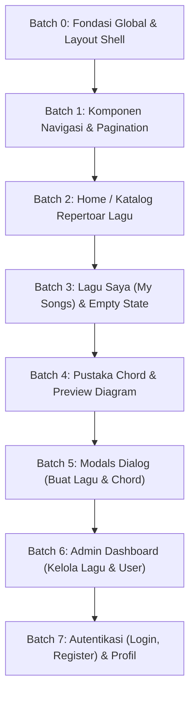

# Rencana Implementasi UI Refactor ChordCue

Dokumen ini adalah panduan kerja refactor tampilan antarmuka ChordCue.
Setiap batch dikerjakan satu per satu secara terisolasi dengan siklus:
`Ubah kode` → `npm run build` → `php artisan test` → `Screenshot 1280px + 375px` → `⛔ Tunggu Review`.

---

## Prinsip Desain Terpilih (Opsi B — Stage & Tape Deck)
1. **Warna:** Tetap tema gelap dan palet warna ChordCue asli (`#0A0F1A`, `#111826`, `#182133`, `#2A3752`, aksen `#5B8DEF`).
2. **Top Master Controls:** Seluruh bar kontrol latihan, HUD metronom 4-LED, dan pengaturan sesi diletakkan di bagian atas (sticky top), membiarkan bagian bawah bersih tanpa gangguan saat membaca lirik/chord.
3. **Tipografi & Ritme Musik:** Huruf tebal berbobot tinggi untuk chord (terbaca dari jarak 1–2 meter pada stand musik), monospace tabular untuk timing/beat/BPM, dan layout lembar terbuka (full-bleed) tanpa kotak kartu kaku di area pembacaan.
4. **Hierarki Aksi Jelas:** Menghapus "Christmas Tree Syndrome" (polusi 3 tombol berwarna mencolok di setiap baris/kartu). Aksi utama ditonjolkan, aksi sekunder tenang, aksi destruktif kontekstual.
5. **Ergonomi Sentuh:** Minimal hit area 44px–48px pada semua tombol dan kontrol sentuh mobile.
6. **Copywriting Alami:** Bahasa Indonesia ramah ("kamu" bukan "Anda"), tanpa teks promosi klise.

---

## Urutan Batch Kerja

---

### Batch 0: Fondasi Global & Layout Shell
- **Tujuan:** Menghapus ornamen murahan "ambient background circles" dari layout utama, merapikan base CSS, dan memastikan kanvas latar belakang gelap pekat yang bersih di seluruh halaman.
- **File yang disentuh:**
  - `resources/views/layouts/app.blade.php`
  - `resources/views/layouts/guest.blade.php`
  - `resources/css/app.css`
- **Perubahan:**
  - Hapus 4 div lingkaran pudar di `layouts/app.blade.php`.
  - Pastikan styling `:focus-visible` keyboard aksesibel dan tajam.
  - Perbaiki scrollbar styling agar tenang di tema gelap.
- **Risiko:** Perubahan layout shell berdampak ke semua halaman.
- **Cara Memeriksa:** Jalankan `npm run build`, buka `http://localhost:8000/`, verifikasi background bersih tanpa bercak lingkaran pudar, jalankan `php artisan test`.

---

### Batch 1: Komponen Navigasi & Pagination (`x-navbar`, `x-pagination`)
- **Tujuan:** Menjadikan navbar ringkas, kokoh, dan menyelesaikan masalah navigasi mobile (menu hamburger yang tidak terlihat/kaku di layar kecil).
- **File yang disentuh:**
  - `resources/views/components/navbar.blade.php`
  - `resources/views/components/pagination.blade.php`
- **Perubahan:**
  - Rapikan brand logo ChordCue dan link navigasi dengan indikator aktif yang halus.
  - Sempurnakan menu mobile dropdown agar nyaman dibuka dengan satu jempol, tap target minimal 44px.
  - Perbaiki `x-pagination` dengan tombol angka dan prev/next yang proporsional.
- **Risiko:** Dropdown profil atau menu hamburger mobile macet saat Alpine.js toggle.
- **Cara Memeriksa:** Buka di desktop 1280px dan mobile 375px, tes klik toggle menu mobile, tes dropdown profile, jalankan `php artisan test`.

---

### Batch 2: Home / Katalog Lagu (`welcome.blade.php` & `x-song-card`)
- **Tujuan:** Mengubah katalog lagu dari kartu seragam AI menjadi tampilan repertoar musik yang padat dan mudah di-scan, merapikan filter dropdown 4-kolom agar tidak memblokir layar mobile.
- **File yang disentuh:**
  - `resources/views/welcome.blade.php`
  - `resources/views/components/song-card.blade.php`
- **Perubahan:**
  - Ganti hero generik "Temukan Lagu" dengan header pencarian ringkas dan fungsional.
  - Tata ulang 4 filter dropdown (Artis, Genre, Mood, Lokasi) menjadi bar horizontal yang kompak di desktop dan filter sheet/drawer yang rapi di mobile.
  - Desain ulang kartu lagu (`x-song-card`) dengan hierarki tajam: Judul lagu tebal, nama artis jelas, BPM & time signature tabular, dan chip tag minimalis tanpa tumpukan ikon dekoratif.
  - Tombol aksi utama "Putar" tegas dan konsisten.
- **Risiko:** Filter query string GET dan paginasi lagu terputus.
- **Cara Memeriksa:** Coba filter kombinasi artis/genre, tes tombol reset filter, tes pagination, ambil screenshot 1280px & 375px, jalankan `php artisan test`.

---

### Batch 3: Halaman Lagu Saya (`my-songs.blade.php` & Empty State)
- **Tujuan:** Menghilangkan "Christmas Tree Syndrome" (3 tombol berwarna di setiap kartu), memperbaiki tombol "+ Buat Lagu" yang terpotong di mobile, dan membuat empty state yang elegan.
- **File yang disentuh:**
  - `resources/views/my-songs.blade.php`
- **Perubahan:**
  - Perbaiki header mobile: tombol `+ Buat Lagu` tidak terpotong dan nyaman ditekan.
  - Tab filter `Public` dan `Private` didesain ulang sebagai segment control studio yang bersih.
  - Sederhanakan tombol aksi per lagu: tombol utama "Putar", tombol sekunder "Edit" (outline tenang), dan aksi destruktif "Hapus" sebagai icon button/menu dropdown konfirmasi yang aman (bukan tombol merah mencolok di setiap kartu).
  - Empty state musisi: panduan singkat membuat lembar chord pertama tanpa kotak ikon besar yang canggung.
- **Risiko:** Form delete token CSRF atau method spoofing DELETE gagal.
- **Cara Memeriksa:** Login sebagai user, tes filter Public/Private, tes klik Buat Lagu (modal muncul), tes konfirmasi hapus lagu, screenshot 1280px & 375px, jalankan `php artisan test`.

---

### Batch 4: Pustaka Chord (`chords/index.blade.php` & `x-chord-card`)
- **Tujuan:** Menghapus warna pastel periwinkle `#9DB9FB` yang silau dan tidak selaras, memperbaiki icon search yang menabrak teks input, dan mempertegas hierarki preview diagram chord.
- **File yang disentuh:**
  - `resources/views/chords/index.blade.php`
  - `resources/views/components/chord-card.blade.php`
  - `resources/views/components/chord-diagram.blade.php`
- **Perubahan:**
  - Perbaiki padding input pencarian agar ikon kaca pembesar tidak menabrak placeholder `Cari Chord...`.
  - Ubah kontainer diagram chord dari warna periwinkle `#9DB9FB` menjadi dark studio surface (`#111826` dengan border `#2A3752` dan diagram berlatar kontras yang nyaman di mata).
  - Kartu chord mini di grid kiri dibuat lebih ringkas dan tajam dengan indikator aktif yang tegas saat dipilih.
  - Panel preview kanan tetap sticky dan elegan.
- **Risiko:** Alpine reactive binding `selectedChord` gagal memperbarui diagram saat kartu diklik.
- **Cara Memeriksa:** Klik berbagai chord di grid kiri, pastikan diagram dan teks pengucapan di kanan berganti instan, verifikasi di 1280px dan 375px, jalankan `php artisan test`.

---

### Batch 5: Modal Dialog (`create-song-modal`, `create-chord-modal`, `edit-chord-modal`)
- **Tujuan:** Standardisasi modal popup form dengan tema dark-blue studio yang konsisten, label input jelas, dan tombol aksi yang ergonomis.
- **File yang disentuh:**
  - `resources/views/components/modal.blade.php`
  - `resources/views/components/create-song-modal.blade.php`
  - `resources/views/components/create-chord-modal.blade.php`
  - `resources/views/components/edit-chord-modal.blade.php`
- **Perubahan:**
  - Scrim overlay yang halus dan fokus trap yang benar.
  - Header modal yang tegas dengan tombol tutup yang mudah dijangkau.
  - Input field dengan border `#2A3752` dan active ring `#5B8DEF` yang bersih.
  - Penempatan tombol Cancel (Secondary) di sebelah tombol Submit (Primary).
- **Risiko:** Interaksi keyboard ESC untuk menutup modal atau form submission gagal.
- **Cara Memeriksa:** Buka setiap modal, tes pengisian form dan error validation state, tes tutup modal dengan tombol silang dan ESC, jalankan `php artisan test`.

---

### Batch 6: Halaman Admin — Kelola Lagu & Kelola User
- **Tujuan:** Mengganti stat card generik ber-icon lingkaran dengan metrik instrumen yang ringkas, serta membersihkan tabel data admin dari banjir tombol aksi warna-warni.
- **File yang disentuh:**
  - `resources/views/admin/songs/index.blade.php`
  - `resources/views/admin/users/index.blade.php`
- **Perubahan:**
  - Ringkaskan stat card atas menjadi strip metrik tabular yang elegan.
  - Rapikan tabel data: baris lebih kompak, badge status (Public/Private/Role) tegas, dan kolom Aksi disederhanakan dengan tombol icon/action group yang rapi.
  - Formulir filter admin (pencarian, role, pemilik) dibuat sejajar dan proporsional.
- **Risiko:** Hak akses admin policy atau form penghapusan user/lagu admin terganggu.
- **Cara Memeriksa:** Login sebagai admin, uji filter tabel, tes pagination admin, screenshot 1280px & 375px, jalankan `php artisan test`.

---

### Batch 7: Autentikasi (Login, Register) & Halaman Profil
- **Tujuan:** Mengharmonisasikan halaman Auth & Profil ke dalam standar studio, memperbaiki copy kaku "Anda" menjadi "kamu" sesuai pedoman, dan memastikan kartu form terlihat matang.
- **File yang disentuh:**
  - `resources/views/auth/login.blade.php`
  - `resources/views/auth/register.blade.php`
  - `resources/views/profile/edit.blade.php`
  - `resources/views/profile/partials/update-profile-information-form.blade.php`
  - `resources/views/profile/partials/update-password-form.blade.php`
  - `resources/views/profile/partials/delete-user-form.blade.php`
- **Perubahan:**
  - Perbarui copy teks antarmuka: ganti kata kaku "Anda" menjadi "kamu".
  - Desain kartu login dan register di tengah layar tanpa bercak lingkaran raksasa di belakangnya.
  - Rapikan halaman pengaturan profil menjadi panel-panel konfigurasi yang bersih.
- **Risiko:** Alur autentikasi Breeze, validasi error Blade, atau password update terganggu.
- **Cara Memeriksa:** Uji login dengan password salah (cek pesan error), uji login berhasil, uji update profil, jalankan `php artisan test`.

---

## Aturan Verifikasi Setiap Batch (Checklist Mandatori)
Sebelum meminta review pada setiap batch:
1. Jalankan `npm run build` (harus sukses tanpa error CSS/JS).
2. Jalankan `php artisan test` (seluruh unit & feature tests harus tetap 100% lulus; tidak boleh mengubah/menghapus tes).
3. Ambil screenshot otomatis via headless Chrome pada resolusi Desktop (**1280px**) dan Mobile (**375px**).
4. Periksa kontras teks (WCAG AA ≥ 4.5:1), keyboard focus ring, dan ukuran tap target minimal 44px.
5. Catat setiap perubahan token atau utility di `01-docs/design-system/design-changelog.md`.
6. Berhenti di ⛔ dan tunggu persetujuan sebelum berpindah ke batch berikutnya.

